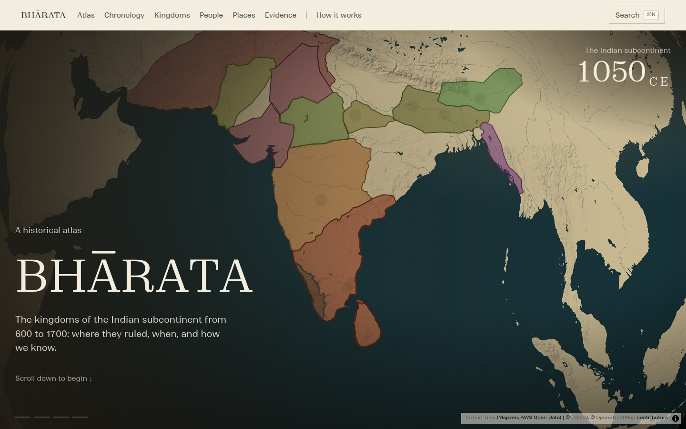
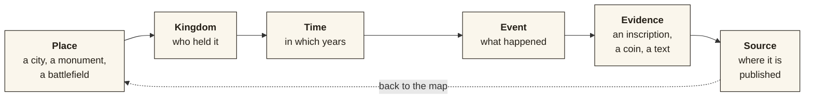
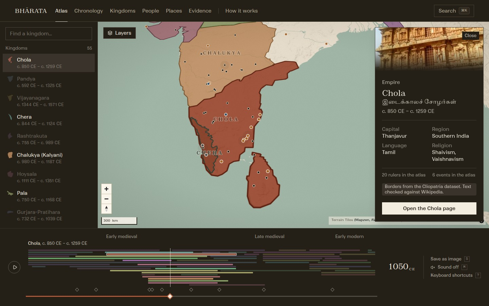
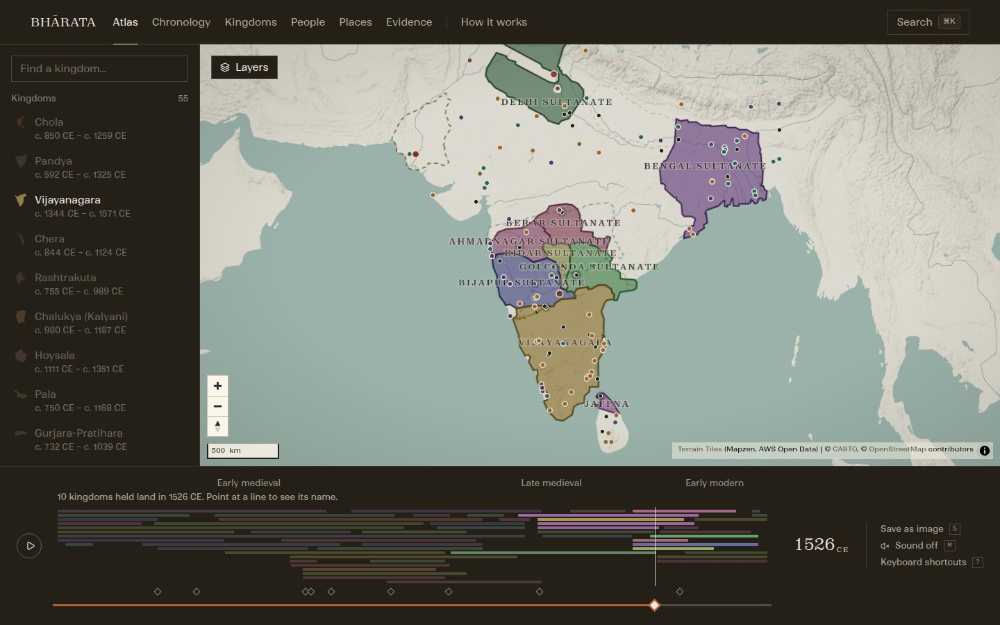
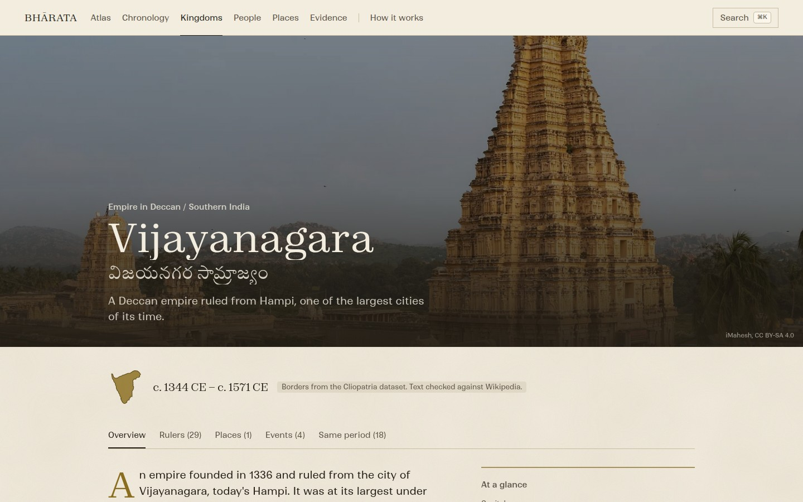
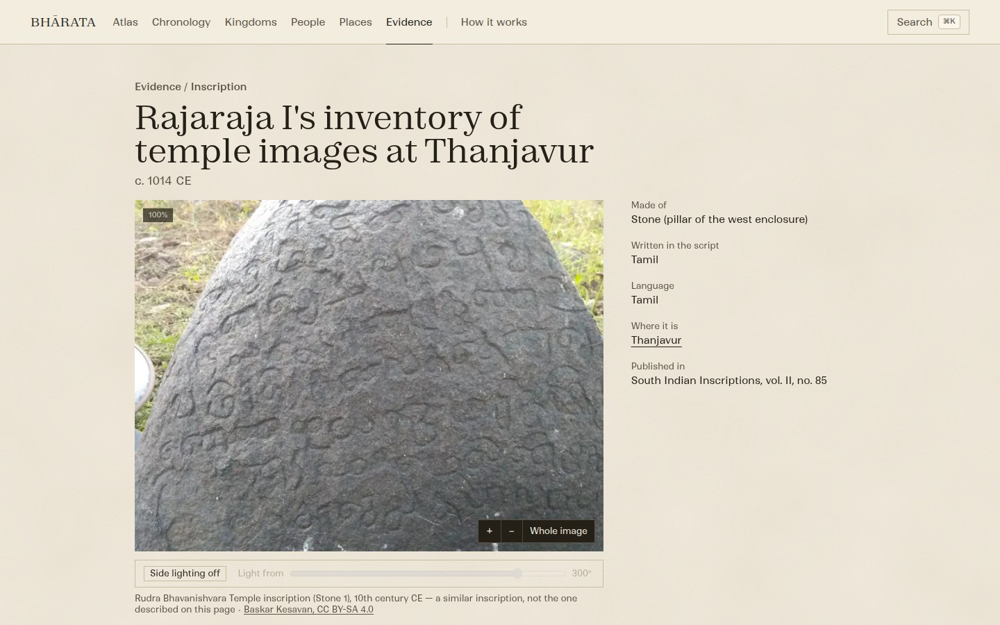
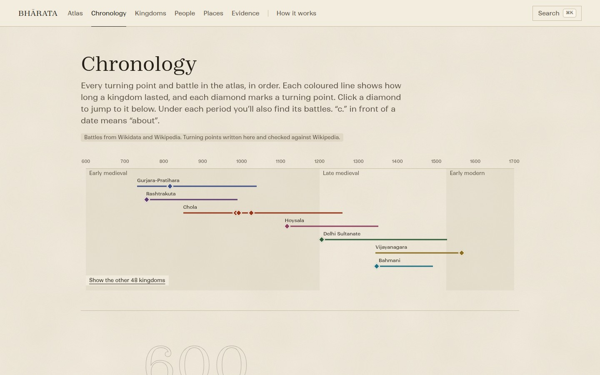
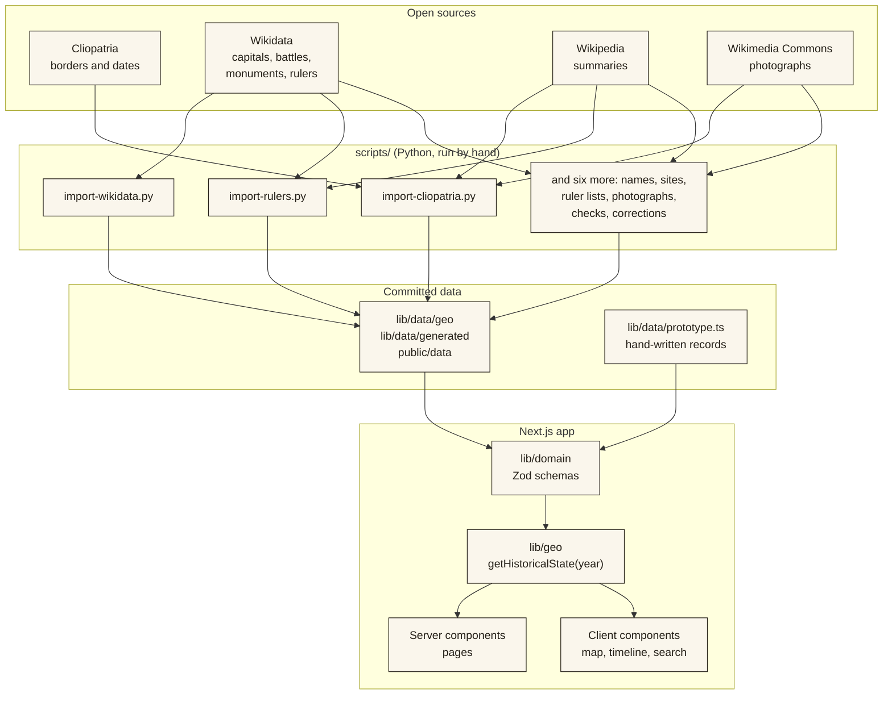

<div align="center">

<br />

# BHĀRATA

### A historical atlas of the Indian subcontinent

Drag a timeline from **600 to 1700 CE** and watch kingdoms grow, shrink and disappear.<br />
Then follow any claim back to the evidence it rests on.

<br />

[](https://bhaarata.vercel.app)
[](https://nextjs.org)
[](https://maplibre.org)
[](https://www.typescriptlang.org)

[**Open the atlas**](https://bhaarata.vercel.app/atlas) · [**How it works**](docs/ARCHITECTURE.md) · [**Where the data comes from**](docs/DATA.md) · [**Backlog**](docs/BACKLOG.md)

<br />



<br />
<br />

</div>

## What is BHĀRATA?

Most maps of Indian history are a single picture: one year, one set of borders, no way to ask *how do we know?* BHĀRATA is built around that question.

It is an interactive atlas where **time is a control**. Move the slider and the map redraws itself: kingdoms fade in as they rise, change shape as they grow, and leave a dashed ghost of their old borders when they fall. Click a kingdom to see who ruled it, what happened there, which battles were fought on its land, and which neighbours it shared the century with. Open a piece of evidence and the page shows every step between the original object and the claim, marking each step as **real**, **partly real** or **placeholder**.

It is not a Wikipedia clone, and it is not a chatbot with a history skin. Every date, border and name is labelled with where it came from, and anything that is still a placeholder says so on the page.

<br />

## The idea in one picture

Every page in the site is one stop on a single loop. The map answers *where*, the timeline answers *when*, and the evidence answers *how we know*.



<br />

## Highlights

<table>
<tr>
<td width="50%" valign="top">

### Travel through time
- **55 kingdoms** and **466 dated border shapes**, 600 to 1700 CE
- Play, pause, or drag; borders crossfade between records
- Land a kingdom lost fades out as a **dashed echo**
- Compare two years **side by side**, with linked cameras
- **Cinema view**, keyboard shortcuts, save the map as an image

</td>
<td width="50%" valign="top">

### Follow the evidence
- Every page names its **sources**, with licences
- A **"How we know"** chain from stone to claim
- Pan and zoom an inscription; **simulated side-lighting** brings out carved letters
- Dates are worded honestly: *reign* vs *lived*, *c.* vs exact

</td>
</tr>
<tr>
<td width="50%" valign="top">

### A map with depth
- **127 battles** appear in the year they were fought
- **344 temples, mosques, forts and tombs** appear in the year they were built
- **4,300 protected monuments**, clustered, off by default
- Ships and travellers move along trade and war routes
- Capital seals, river flow, relief, and an era tint
- A 3D-tilted camera that flies to what you select

</td>
<td width="50%" valign="top">

### Built to be read
- Plain language everywhere; no jargon
- Typeset in **Zodiak** and **Ranade**, with Tamil, Kannada, Telugu and Devanagari fonts
- A **⌘K** search that also jumps to any year
- Works on phones, respects reduced motion, keyboard-operable
- A film-like opening: a globe, a starfield, and an orbital descent

</td>
</tr>
</table>

<br />

## A look around

<table>
<tr>
<td width="50%"><br /><sub><b>The atlas.</b> 1050 CE, the Chola selected, the kingdom timeline underneath.</sub></td>
<td width="50%"><br /><sub><b>1526 CE.</b> The Deccan sultanates, Bengal, Delhi and Vijayanagara side by side.</sub></td>
</tr>
<tr>
<td width="50%"><br /><sub><b>A kingdom page.</b> Rulers, places, events, neighbours, sources.</sub></td>
<td width="50%"><br /><sub><b>Evidence.</b> A translation from <i>South Indian Inscriptions</i>, with the viewer above it.</sub></td>
</tr>
<tr>
<td colspan="2"><br /><sub><b>The chronology.</b> One line per kingdom (the seven with turning points first, the other 48 one click away), one diamond per turning point, battles listed under each period.</sub></td>
</tr>
</table>

<br />

## What is real, and what is not

BHĀRATA is an early version, and being straight about that is part of the project. The table says exactly which parts come from open research data and which are still hand-written placeholders.

| Layer | Source | Status |
|---|---|---|
| Kingdom borders and dates | [Cliopatria](https://github.com/Seshat-Global-History-Databank/cliopatria) (Seshat Global History Databank, CC BY 4.0) | Researched. One version of each territory, **not exact frontiers** |
| Kingdom summaries | Wikipedia (CC BY-SA 4.0) | Opening paragraphs, lightly trimmed |
| Capitals, battles, dated sites, monuments, rulers | Wikidata (CC0) and Wikipedia's lists of rulers | Real. Every kingdom has rulers; a few have only one to four because the sources name no more |
| Photographs | Wikimedia Commons | Real, credited; only free licences |
| Names in Tamil, Kannada, Persian and other scripts | Wikidata labels | Real, but **not yet checked by a reader of each language** |
| Inscription evidence | *South Indian Inscriptions* Vol. II (1913, public domain) | **Two** real translations so far |
| Hand-written texts, eleven rulers, nine turning points | This repository | Written here and **checked against Wikipedia**, statement by statement; the source is named on each page |
| Chera borders, two example routes | This repository | **Not researched**, labelled on the page and the map |

Every page shows a badge saying which of these it uses. The full account, with licences and known gaps, is in [`docs/DATA.md`](docs/DATA.md).

<br />

## How it works

BHĀRATA is a Next.js app with no database yet. Open data is imported once by Python scripts (the three main ones are drawn below), validated, and written to JSON that ships with the site. Server components render the pages; only the map, timeline and search run in the browser.



One function, `getHistoricalState(year)`, answers *what does the world look like in year Y*. The timeline, the map and the preview panel all call it, so they can never disagree. The deeper tour, with the map's layer stack and the per-frame update path, is in [`docs/ARCHITECTURE.md`](docs/ARCHITECTURE.md).

<br />

## Tech stack

| | |
|---|---|
| **Framework** | [Next.js](https://nextjs.org) 16 (App Router, React Server Components), React 19, TypeScript 5 |
| **Map** | [MapLibre GL JS](https://maplibre.org) 6: globe projection, hillshade, 3D terrain, `feature-state`. Glyphs generated from the project's own fonts |
| **Styling** | Tailwind CSS 4 with design tokens; [Motion](https://motion.dev) for animation; the browser's View Transitions for page changes |
| **Interface parts** | Radix UI (dialog, tabs, popover, tooltip), [cmdk](https://cmdk.paco.me) for search, Lucide icons |
| **Data contracts** | [Zod](https://zod.dev) 4 |
| **Import scripts** | Python 3 with `shapely` (and Pillow, only to choose photographs) |
| **Hosting** | [Vercel](https://vercel.com) |

<br />

## Getting started

You need **Node.js 20 or newer** and npm.

```bash
git clone git@github.com:varunaditya27/BHAARATA.git
cd BHAARATA

npm install            # also copies MapLibre's web worker into public/vendor
cp .env.example .env.local

npm run dev            # http://localhost:3000
```

| Command | What it does |
|---|---|
| `npm run dev` | Development server with hot reload |
| `npm run build` | Production build (also type-checks) |
| `npm run start` | Serve the production build |
| `npm run lint` | ESLint |

Only one environment variable is used: `NEXT_PUBLIC_SITE_URL`, the public address of the site, which link previews need. See [`docs/DEVELOPMENT.md`](docs/DEVELOPMENT.md) for deployment, the verification checklist and troubleshooting.

<br />

## Using the atlas

| Key | Action | | Key | Action |
|---|---|---|---|---|
| `Space` | Play or pause | | `C` | Full-screen cinema view |
| `J` / `K` | Back or forward 10 years (`Shift`: 50) | | `V` | Compare two years |
| `,` / `.` | Previous or next event | | `S` | Save the map as an image |
| `1`–`9` | Select a kingdom | | `M` | Background sound on or off |
| `Esc` | Deselect | | `?` | Show every shortcut |
| `⌘K` / `Ctrl K` | Search, or type a year (such as `1192`) to jump to it | | | |

<br />

## Project layout

```text
app/                 Routes. Server components by default.
components/
  atlas/             The atlas screen, shortcuts, cinema and compare views
  chronology/        Timeline scrubber, kingdom lanes, event ticks
  entity/            Kingdom, ruler and place building blocks
  evidence/          Image viewer, provenance chain, side-lighting
  home/              The opening film: globe, starfield, wordmark
  layout/            Navigation and footer
  map/               MapLibre lifecycle, layers, per-frame updates
  primitives/        Small, logic-free building blocks
  search/            The ⌘K palette
lib/
  domain/            Zod schemas and types, date formatting
  data/              Hand-written records, generated data, image credits
  geo/               getHistoricalState(year), GeoJSON conversion
  search/            The search index behind the ⌘K palette
  utils/             Small helpers (class names, colour, stored flags, page-transition types)
scripts/             Python importers, the data checker, and the MapLibre worker copy
assets/              Fonts for the share images
docs/                Architecture, data, design, development, backlog
public/              Fonts, map glyphs and style, images, monuments
```

<br />

## Documentation

| Document | Read it for |
|---|---|
| [`docs/ARCHITECTURE.md`](docs/ARCHITECTURE.md) | How the app is put together, with diagrams |
| [`docs/DATA.md`](docs/DATA.md) | Every data source, its licence, how to refresh it, known gaps |
| [`docs/DESIGN.md`](docs/DESIGN.md) | Typography, colour, motion, and the rules for writing the interface's words |
| [`docs/DEVELOPMENT.md`](docs/DEVELOPMENT.md) | Setup, deployment, verification, troubleshooting |
| [`docs/BACKLOG.md`](docs/BACKLOG.md) | What is unfinished, ranked, with sizes |
| [`PROJECT_BIBLE.md`](PROJECT_BIBLE.md) | The product's purpose, values and non-negotiables |
| [`AGENTS.md`](AGENTS.md) | Working rules for AI coding agents (mirrored by `CLAUDE.md`) |

<br />

## Contributing

Corrections are the most valuable contribution: a border that is wrong, a date that disagrees with a source, a ruler missing from a list. Open an issue with the page link and the source you are going by.

For code, three rules matter more than any others:

1. **Never invent history.** No made-up dates, rulers, sources or borders. If a record has no source, it must say so on the page.
2. **Keep dates honest.** Use `formatDateRange()` and `formatPersonDates()`; never print a lifetime as a reign.
3. **Run the app, not just the build.** Click through your change, with the keyboard too, before calling it done.

<br />

---

<div align="center">

<br />

**BHĀRATA**

Borders from [Cliopatria](https://github.com/Seshat-Global-History-Databank/cliopatria) · Facts from [Wikidata](https://www.wikidata.org) and [Wikipedia](https://www.wikipedia.org) · Photographs from [Wikimedia Commons](https://commons.wikimedia.org)<br />
Base map © [CARTO](https://carto.com), © [OpenStreetMap](https://www.openstreetmap.org/copyright) contributors · Terrain from Mapzen via AWS Open Data<br />
Set in Zodiak and Ranade ([Indian Type Foundry](https://www.indiantypefoundry.com)), Anek ([Ek Type](https://ektype.com)) and Tiro ([Tiro Typeworks](https://tiro.com))

Full credits and licences are on the site's [Method page](https://bhaarata.vercel.app/method#credits).

<br />

[Live site](https://bhaarata.vercel.app) · [Backlog](docs/BACKLOG.md) · [Report a correction](https://github.com/varunaditya27/BHAARATA/issues)

<br />

</div>
