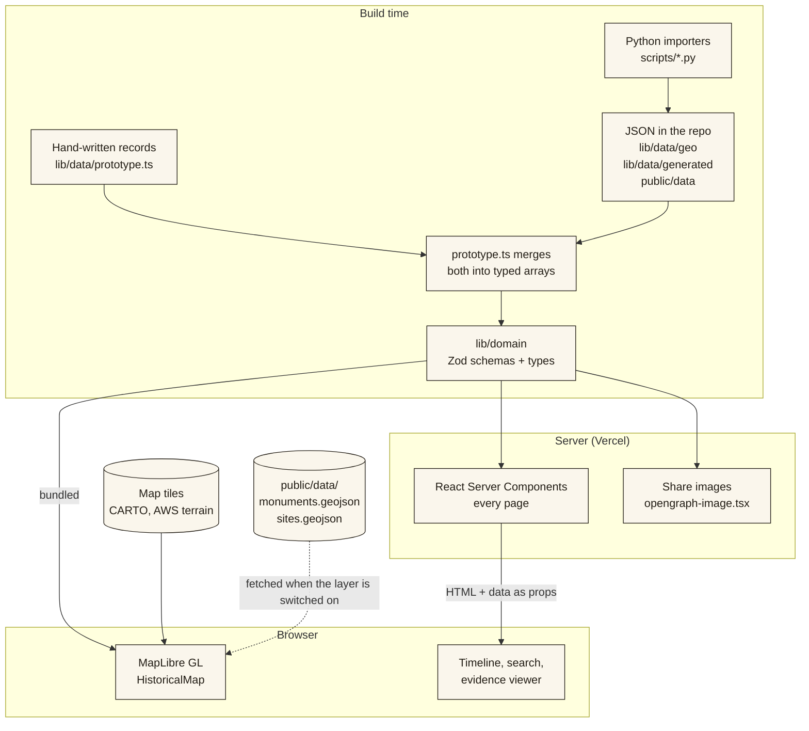
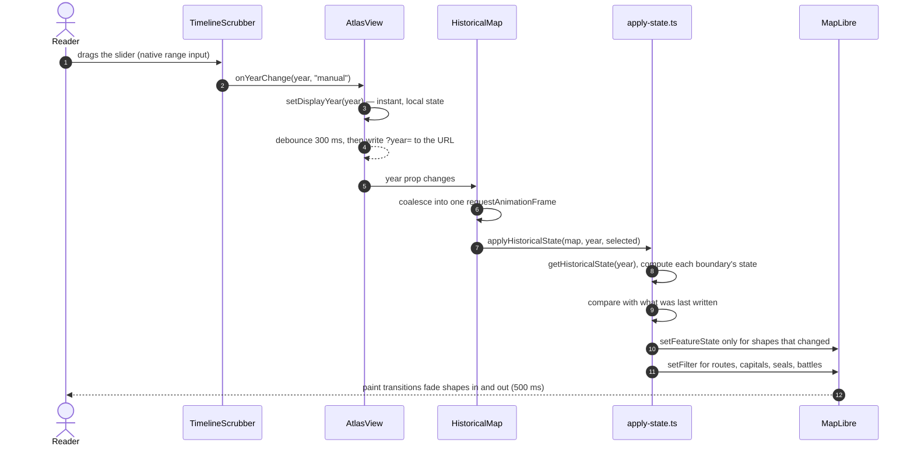
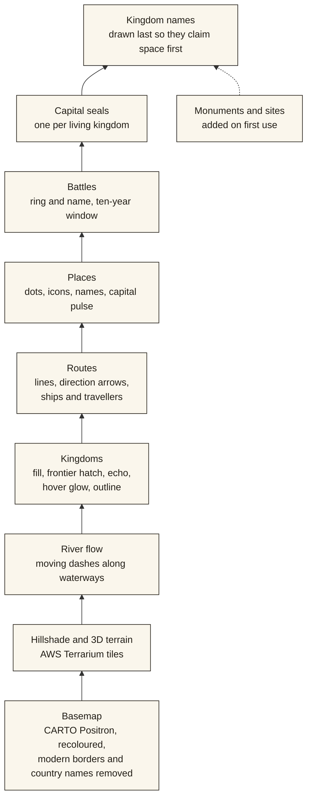
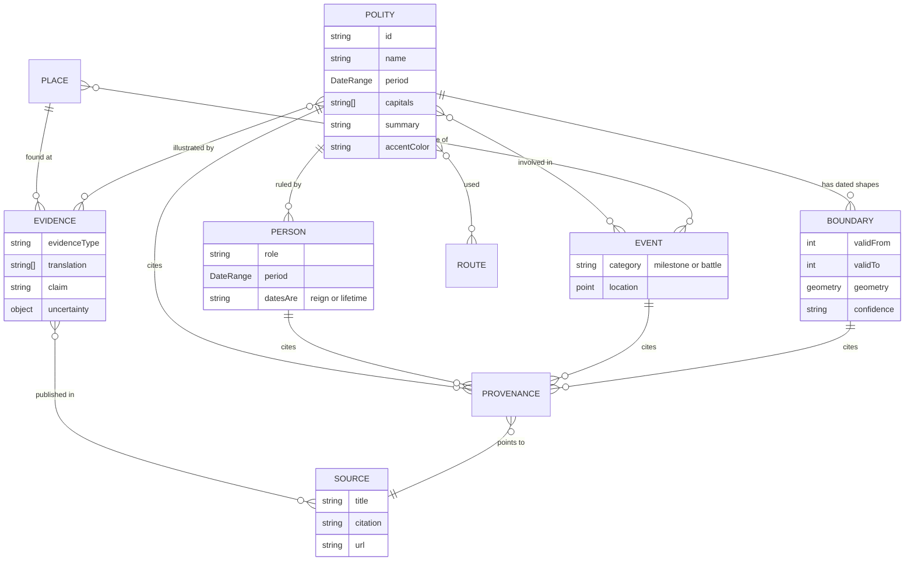
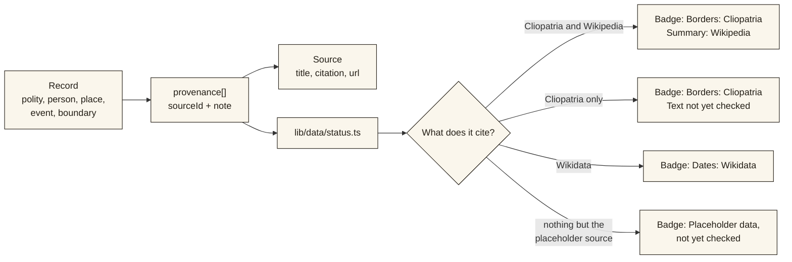
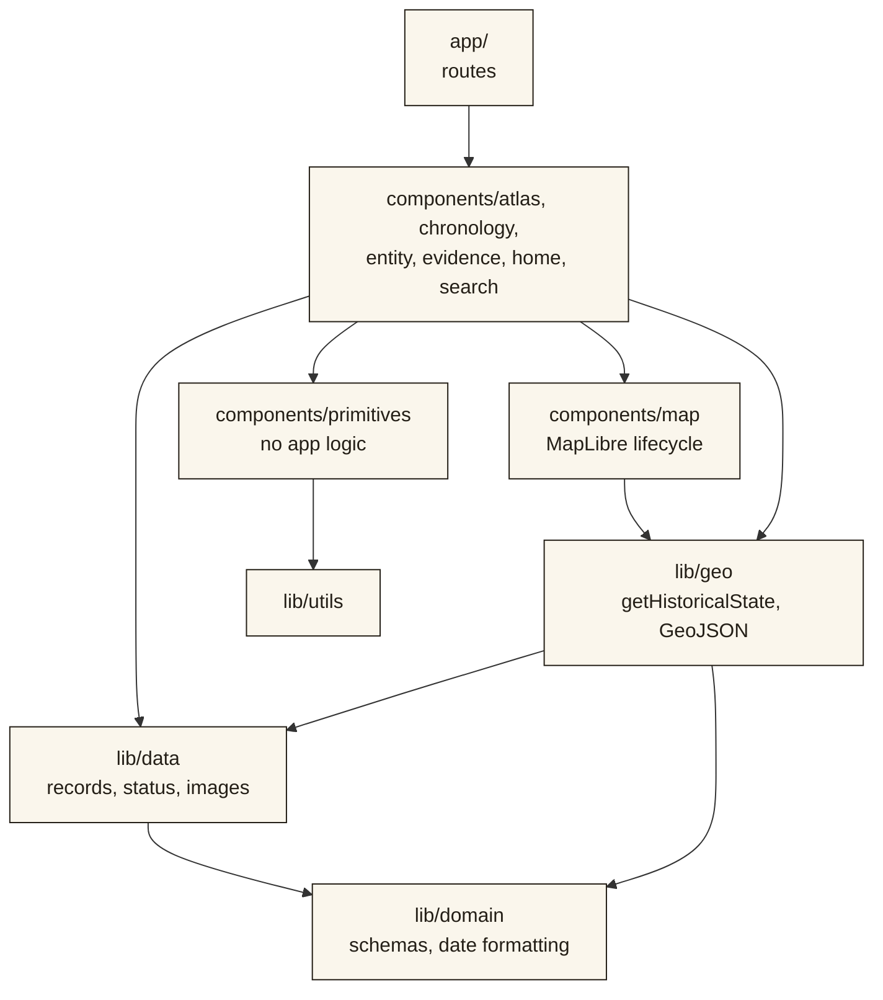
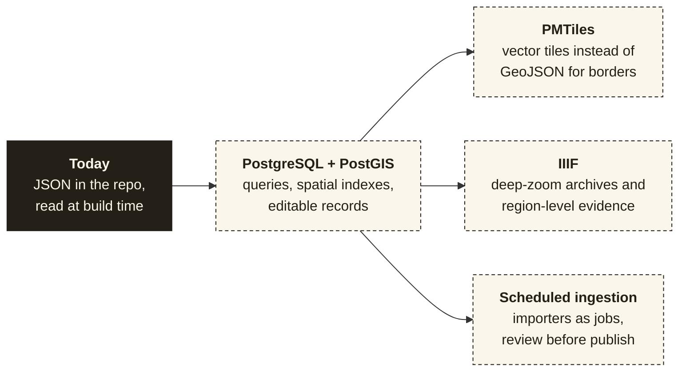

# Architecture

How BHĀRATA is put together, and why.

[← Back to the README](../README.md)

---

## Contents

1. [Principles](#1-principles)
2. [The big picture](#2-the-big-picture)
3. [Server and client](#3-server-and-client)
4. [From a dragged slider to a repainted map](#4-from-a-dragged-slider-to-a-repainted-map)
5. [The map](#5-the-map)
6. [The domain model](#6-the-domain-model)
7. [Provenance](#7-provenance)
8. [State](#8-state)
9. [Module boundaries](#9-module-boundaries)
10. [Performance notes](#10-performance-notes)
11. [Decisions](#11-decisions)
12. [Where this is heading](#12-where-this-is-heading)

---

## 1. Principles

Four ideas decide most questions.

| Principle | What it means in practice |
|---|---|
| **The interface shows relationships, not records** | A page links outward (a ruler to a kingdom, a battle to the borders it fell inside, a claim to its source) instead of listing fields. |
| **One function answers "what is the world like in year Y?"** | `getHistoricalState(year)` in `lib/geo/historical-state.ts`. The timeline, the map and the preview panel all call it. Nothing else re-derives "is this kingdom active?". |
| **The map owns geography; React owns everything around it** | React never re-renders the map. It calls MapLibre's own APIs (`setFeatureState`, `setFilter`, `flyTo`), and the map is never remounted when the year or selection changes. |
| **Unknown is not empty** | Every date carries a confidence and a qualifier. A record without a source says so on its page. Data that is missing is shown as missing, never as zero. |

---

## 2. The big picture

There is no database and no API server. All data is committed to the repository as JSON, validated by Zod schemas, and read at build time.

The importers are run by hand and their output is committed. That keeps builds fast and offline, makes every data change reviewable in a diff, and means the deployed site never depends on Wikidata or Wikipedia being reachable.

---

## 3. Server and client

Pages are server components. Only the parts that need the browser are client components.

| Runs on the server | Runs in the browser (`"use client"`) |
|---|---|
| All `app/**/page.tsx` routes | `AtlasView` and everything inside it |
| Kingdom, person, place and evidence pages | `HistoricalMap`, `StoryMap` (the homepage globe) |
| `KingdomLanes`, `ProvenanceChain`, `Colophon` | `TimelineScrubber`, `LifespanStrip`, `EventTicks` |
| Share images (`opengraph-image.tsx`, rendered once at build) | `CommandPalette`, `EvidenceViewer`, `RakingLight` |
| Static metadata and `generateStaticParams` | `EntityPreviewPanel`, `MobileMenu`, `NavLinks` |

Every kingdom, person, place and evidence page is pre-rendered with `generateStaticParams`. Next.js splits code per route, so MapLibre only ships with the homepage and the atlas; the homepage additionally loads its globe lazily (`dynamic(..., { ssr: false })` in `HomeFilm.tsx`) so the title and text paint first.

---

## 4. From a dragged slider to a repainted map

This is the hottest path in the app. A drag can produce dozens of changes a second, so each stage does as little as possible.

Three details make this smooth:

- **The year is local state first, URL second.** Writing to the URL on every tick made scrubbing sluggish. The URL catches up 300 ms after the last change, so links still work.
- **Only changed shapes are touched.** With 466 border shapes, rewriting all of them every frame would be wasteful. `apply-state.ts` keeps a signature per shape and skips the ones that are unchanged. A typical frame touches a handful.
- **The map fades; React does not.** Opacity changes are `feature-state` values with paint transitions, so MapLibre animates them on the GPU.

---

## 5. The map

### Lifecycle

`HistoricalMap` creates the map once. Everything that happens afterwards is an effect that talks to the existing map.

- **A ready flag and a queue.** MapLibre's `isStyleLoaded()` reports `false` while tiles are loading, which silently dropped updates. Instead, work requested before the map is ready is queued by key (the latest request of each kind wins) and run when the map reports ready.
- **"Ready" means the first complete frame**, judged from the basemap and the historical sources, but not from terrain tiles, which are decoration that can fill in afterwards. A 4-second fallback means a stuck tile can never leave the loading cover up forever.
- **The web worker is self-hosted** (`scripts/copy-maplibre-worker.mjs`, run on `npm install`), because Turbopack does not serve MapLibre's worker from `node_modules`.
- **Glyphs come from the project's own fonts** (`public/map-glyphs/`), so labels match the rest of the site and no third-party font server is called.

### Layer stack

Layers are added once, in a fixed order. Roughly bottom to top:

The definitions live in `components/map/layers.ts`; ids are in `mapStyle.ts`. Each legend toggle maps onto a group of these layers (`TOGGLE_LAYER_MAP` in `HistoricalMap.tsx`).

### What drives each layer

| Layer | Driven by | Updated how |
|---|---|---|
| Kingdom fill, outline, labels | `feature-state` per border shape | Diffed in `applyHistoricalState` |
| Frontier hatch | `feature-state` | Only Chera has a hatched band |
| Echo (dashed ghost of lost land) | `feature-state: echoOpacity` | Fades over 60 years after a kingdom ends |
| Routes, capitals, seals, battles | A `filter` expression | `setFilter` once per year change |
| Ships and travellers | A GeoJSON source rewritten ~30 times a second | `animations.ts`, one shared clock |
| Hover glow and label | `feature-state: hover` plus a DOM label | Written directly; no React render per mouse move |
| Monuments | Static GeoJSON with clustering | Fetched when first switched on |
| Sites (344 temples, forts, tombs…) | Static GeoJSON; a `filter` on each site's build year | Fetched when first switched on; `setFilter` once per year change |

### Related behaviours

- **Selecting a kingdom** flies the camera to its borders, tilts it when terrain is on, and pads the view so the shape sits clear of the preview card (desktop) or bottom sheet (mobile).
- **Compare view** runs a second `HistoricalMap` at its own year. The two cameras are linked in both directions with a re-entrancy guard so they cannot echo each other.
- **Save as image** copies the WebGL canvas inside the next `render` event (the buffer is cleared after each frame) and draws a key and credits onto it.
- **Click handling** gives battles, monuments and clusters priority over the kingdom underneath. Popup content is built with `textContent`, never HTML, because names come from Wikidata.

---

## 6. The domain model

The schemas are in `lib/domain/types.ts`. This is the model as built; `PROJECT_BIBLE.md` describes the fuller target.

A few choices worth knowing:

- **Places do not belong to a kingdom.** Which kingdoms held a place is *computed*, by testing the place's coordinates against every border shape (`boundariesContaining` in `lib/geo/silhouette.ts`). Nothing is entered by hand, so it cannot drift out of date.
- **Battles are linked to kingdoms the same way**: by whose borders contained the site that year, not by who fought. Wikidata rarely records the combatants, and the pages say so.
- **A polity can have many boundary shapes.** A shape is valid for a range of years; the id is `${polityId}-${validFrom}`.
- **`DateRange` carries a confidence and a qualifier** for each end (`exact`, `circa`, `before`, `after`, `unknown`). `formatDateRange()` is the only way dates are printed.

---

## 7. Provenance

Every record that carries a claim has a `provenance` list pointing at `Source` records. A small helper turns that list into the badge shown on the page, so the label can never disagree with the data.

The evidence page goes one step further. `ProvenanceChain` lists each link between the object and the claim (object, photograph, original text, translation, claim, source) and marks each **real**, **partly real** or **placeholder**. A claim is only as strong as its weakest link, so the whole chain is shown.

---

## 8. State

| State | Where it lives | Why |
|---|---|---|
| Year and selected kingdom | URL (`?year=1050&polity=chola`) | A link is a saved historical viewpoint |
| The year while dragging | React state in `AtlasView` | Instant; the URL follows 300 ms later |
| Layer toggles, playing, cinema, compare, help | React state in `AtlasView` | Short-lived interface state |
| Sound on/off | `localStorage` via `useStoredFlag` | A remembered preference; reads as "off" during server render |
| Recent searches | `localStorage` | A convenience; every access is wrapped in `try/catch` |
| Map camera | MapLibre | Never mirrored into React |

---

## 9. Module boundaries

Dependencies point downwards only. A lower layer never imports from a higher one.

| Rule | Reason |
|---|---|
| Domain logic (dates, year-range tests) lives in `lib/`, never in components | One place to fix, one place to test |
| `components/primitives` has no app knowledge | They stay reusable and easy to restyle |
| Historical geometry is data, never JSX or hand-drawn SVG paths | Borders must be checkable and replaceable |
| `components/map` is the only code that touches MapLibre | Keeps the map lifecycle in one place |

---

## 10. Performance notes

| Concern | What is done |
|---|---|
| Scrubbing with 466 shapes | Only changed shapes are written each frame (see section 4). A 900-year drag held 60 fps in a software-rendered test browser |
| 4,300 monuments, 344 sites | Separate GeoJSON files (780 KB together), fetched only when the layer is first enabled, clustered by MapLibre |
| 60+ kingdoms on the timeline | Kingdoms that never overlap share a row, so about 14 rows instead of 60 |
| Map load time | Terrain tiles are not waited for; the cover lifts as soon as the basemap and borders are drawn (about 1–3 s) |
| Homepage globe | Starfield on a plain 2D canvas; the nebula is painted once off-screen; the camera path is one `requestAnimationFrame` loop |
| Share images | Rendered once per kingdom at build time and cached |
| Fonts | Latin fonts are self-hosted; the Indic-script fonts are not preloaded, so they download only when a page uses them |
| Reduced motion | Starfield stays still, the globe jumps to its final view, the map's ambient animation does not start |

---

## 11. Decisions

| Decision | Why | Revisit when |
|---|---|---|
| **No database yet** | The dataset is small enough to ship as JSON; builds stay offline and reviewable | Users can submit corrections, or the data outgrows the bundle |
| **Cliopatria for borders** | A published, cited, openly licensed dataset beats borders drawn by hand | A scholar supplies better outlines for a region |
| **Python importers, committed output** | Reproducible and cached, and the live site never calls Wikidata | The importers need to run on a schedule |
| **Own map glyphs** | The default font server blocks cross-origin requests, and labels should match the site's type | Never, unless the type changes |
| **Monuments undated** | Wikidata has no construction dates for them in this period; inventing some would break the data policy | A dated source (an ASI register, a gazetteer) is found |
| **Borders linked by containment** | Honest about what the data supports (location, not combatants) | A source records who fought |
| **Native `<input type="range">` for the timeline** | Keyboard and screen-reader support for free | Never |
| **Next.js View Transitions for pages** | Shared-element morphs between a list and a page with no extra library | The browser support story changes |

---

## 12. Where this is heading

Planned, not built. Items and their sizes are in [`BACKLOG.md`](BACKLOG.md).

