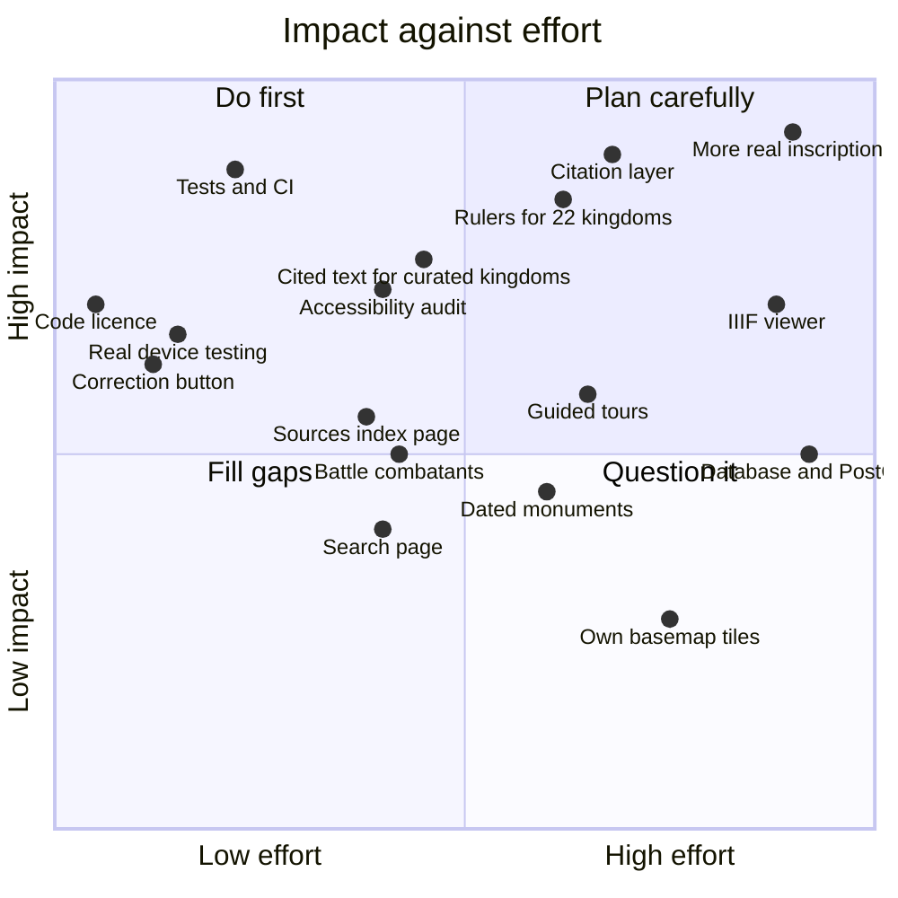

# Backlog

What is unfinished, why it matters, and roughly how big it is.

[← Back to the README](../README.md)

---

## How to read this

| | |
|---|---|
| **Priority** | **P0** do next, it blocks trust or progress · **P1** high value · **P2** worth doing · **P3** later |
| **Size** | **S** under a day · **M** a few days · **L** a week or two · **XL** a project of its own |
| **IDs** | `D` data and content · `F` features · `T` tests and tooling · `K` known issues |

The product's central promise is *"you can see how we know this"*. So **data and evidence come before features**: a new feature on top of placeholder content adds polish but not trust.

---

## At a glance

Where the larger items sit by effort and by how much they change the product.

---

## P0: do next

| ID | Item | Why it matters | Size |
|---|---|---|---|
| **T1** | **Automated tests.** Unit tests (Vitest) for `formatDateRange`, `formatPersonDates`, `getHistoricalState`, the status badges and the importers' outputs. Browser tests (Playwright) for: open the atlas, select a kingdom, scrub, open its page, search, go back | Every check today is manual. A date-formatting bug would silently print wrong history | M |
| **T2** | **Continuous integration.** A GitHub Action running lint, type-check, build and the tests on every pull request | Catches the breakage that "it built on my machine" misses | S |
| **T8** | **Real-device testing.** An ordinary Android phone, an iPhone with Safari, an older laptop. Especially compare view (two maps), 3D terrain, and the homepage globe | Everything so far was tested in a desktop and a software-rendered headless browser | S |
| **T14** | **Choose a licence for the code.** The repository has none, so by default nobody may reuse it. The data has its own licences ([`DATA.md`](DATA.md#2-sources-and-licences)) | Needed before anyone can contribute or reuse it. Needs an owner decision | S |

---

## P1: high value

### Data and content

| ID | Item | Why it matters | Size |
|---|---|---|---|
| **D1** | **Rulers for the 22 kingdoms still with none** (Harsha's Empire, Pratihara, Pala, Chandela, Chauhan, Yadava, Kampili, the Nayaks, the Marathas, …), plus those with only one or two. Four (Utpala, Lohara, Kashmir Sultanate, Paramara) now come from Wikipedia's dated list tables (`import-ruler-lists.py`); each other kingdom needs its list page read by eye first, because layouts differ. A cited textbook is the other route | A kingdom page with no rulers looks unfinished | L |
| **D4** | **A citation layer down to page numbers.** Add a *Claim* record (the statement) that points to a *Source* with a page or inscription number and, where possible, a quoted line. Today a record cites a source as a whole | Turns "Wikipedia" into "Nilakanta Sastri, *The Cōḻas*, p. 214", which is what a historian can check | L |
| **D5** | **Replace the hand-written text of the 10 curated kingdoms** (summaries, taglines, "remembered for") with cited text, then have someone who knows the history review it | It is the largest remaining body of unchecked prose | M |
| **D2** | **More real evidence.** Start with the Chola: more of the Thanjavur inscriptions in *South Indian Inscriptions* Vols. II and III; a coin with a museum catalogue number; a temple with its ASI record. Each needs a free-licence photograph **of that object** | Today there is one real translation, shown beside a photo of a *different* inscription | XL |

### Features

| ID | Item | Why it matters | Size |
|---|---|---|---|
| **F11** | **A "Report a correction" link on every page**, opening a GitHub issue with the page address filled in | The simplest way to get expert corrections, and the README already invites them | S |

### Tests and tooling

| ID | Item | Why it matters | Size |
|---|---|---|---|
| **T5** | **Loading and error states.** Themed `loading.tsx` skeletons; a clear message when map tiles fail; error boundaries around the map and the evidence viewer | A failed tile server currently means a blank map | M |
| **T6** | **Accessibility audit.** Test with VoiceOver and NVDA; check colour contrast on every pigment; give the map a proper text alternative (a readable list of "what is on the map in this year") | The site is designed to be accessible but has never been checked with real assistive technology | M |
| **T7** | **Performance budget.** Bundle analysis, Lighthouse on a mid-range phone, and a target for the atlas and the homepage | MapLibre is large; this is where regressions will creep in | M |

---

## P2: worth doing

### Data and content

| ID | Item | Why it matters | Size |
|---|---|---|---|
| **D3** | **Transcribe the Tamil text** of SII Vol. II no. 85, with line-by-line regions on a photograph of that stone. The scan's machine reading is unusable, so this needs a proper edition, a keyed transcription, or the original stone | Unlocks the line-by-line linking the evidence viewer already supports | M |
| **D6** | **Cited turning points.** The nine hand-written milestones become sourced; add more kinds of event (temple foundations, treaties, famines, coronations) | Playback would have more to say, honestly | L |
| **D9** | **Dated monuments.** Find a source with construction dates (ASI registers, gazetteers, Wikipedia infoboxes) so the monuments layer can follow the timeline | Today it is "protected today", not tied to a year | L |
| **D10** | **Battle combatants.** Read "belligerents" from Wikipedia infoboxes and Wikidata `participant`, and show "fought between X and Y" when known | Today a battle is linked to whose land it was on, which is not who fought | M |
| **D12** | **Photographs for the 3 kingdoms that have none** (Maitraka, Lohara, Dambadeniya), and more of the ~190 rulers. Commons has no photograph of their own sites; a checked museum or archive image would do | Photo-less kingdoms feel second-class | M |
| **D13** | **Check the native-script names** with a reader of each language. They are Wikidata labels, not verified, and two were already wrong (a city's name, and "Sultanate" for a Hindu dynasty) | A wrong name in a native script is worse than none | S |
| **D16** | **More places than capitals.** Ports, temples, forts and towns from Wikidata, with dates where they exist | The map has few places between the capitals | L |
| **D17** | **Chera outline.** The one kingdom still using a district-union placeholder; Cliopatria has no entry | A visible exception | S |
| **D18** | **Reconcile text and map dates.** Examples: the Delhi Sultanate's text says 1206 but its borders start in 1210; the Chola end in 1259 on the map and 1279 in the text | Small contradictions erode trust | S |
| **D8** | **A border review process.** Invite a historian to mark disputed borders; show a kingdom's alternative extents; record who reviewed what | The honest answer to "are these borders right?" | XL |

### Features

| ID | Item | Why it matters | Size |
|---|---|---|---|
| **F1** | **IIIF viewer.** Deep zoom for real archive images, with region annotations linking a stretch of an inscription to a transcribed line and a claim | The signature feature the evidence page is built towards. Needs real images first (D2) | XL |
| **F2** | **A search page** with filters (kingdom, century, type) and queries like "11th century" or "Tamil Nadu" | The palette finds names and years but cannot filter | M |
| **F3** | **Guided tours.** Curated paths such as "The Chola world in 1014" that set the year, the camera and the layers, with a sentence at each stop | The best way in for a first-time visitor | L |
| **F4** | **Camera and layers in the URL**, so a link reproduces exactly what you were looking at | Today only the year and kingdom are saved | S |
| **F17** | **A sources index** (`/sources`): every source the site cites, what it supports, and its licence | Makes provenance browsable, not just per-page | M |

### Tests and tooling

| ID | Item | Why it matters | Size |
|---|---|---|---|
| **T3** | **PostgreSQL with PostGIS**, and importers run as jobs with a review step before data goes live | Needed once records are edited or the data outgrows the bundle | XL |
| **T10** | **Analytics and error tracking** (Vercel Analytics, web vitals) | To see which pages people use and where the app fails | S |
| **T11** | **Harden the importers:** validate every output with the Zod schemas, pin the Python dependencies in a `requirements.txt`, and add one `npm run import:data` wrapper | Today they are scripts you must know how to run | M |
| **T15** | **Search-engine basics:** `robots`, a sitemap, share images for people, places and evidence, structured data | Only kingdom pages have share images | S |

---

## P3: later

| ID | Item | Size |
|---|---|---|
| **D11** | Portraits for more of the ~190 rulers (35 have one), using coins as a fallback | M |
| **D14** | Extend the range beyond 600–1700 (Cliopatria covers far more); needs new era names and a lighter map at wider ranges | L |
| **D15** | Replace the hand-drawn trade and war routes with routes from a scholarly source | L |
| **F5** | Sidebar filters: by region, religion or ruler; group kingdoms by era | M |
| **F7** | Compare view: URL state, a "what changed" summary, a phone layout (it is hidden below tablet width today) | M |
| **F8** | `G` then a letter for keyboard navigation between sections | S |
| **F9** | Offline use (a progressive web app) | M |
| **F15** | An interface in Hindi, Tamil and other languages | XL |
| **T4** | PMTiles for borders and monuments, instead of GeoJSON | L |
| **T9** | Replace the CARTO basemap with the project's own tiles | L |
| **T12** | Image weight (about 26 MB in the repository): compress, or move to a CDN | S |
| **T13** | Split the ~1,000-line `lib/data/prototype.ts` into separate files per record type | M |

---

## Known issues

Small, real problems, kept honest.

| ID | Issue | Where |
|---|---|---|
| **K1** | In crowded periods (the 1500s Deccan), kingdom names overlap on the map | Atlas, ~1500–1600 |
| **K2** | The timeline strip is dense with 55 kingdoms, and the hover tooltip can sit over neighbouring bars | Atlas bottom panel |
| **K3** | Compare view is hidden below tablet width | Atlas on phones |
| **K4** | Some imported summaries start mid-thought or are replaced by a dataset line ("Appears in the Cliopatria … dataset from 561 to 874") | Turk Shahis, Anuradhapura |
| **K5** | The evidence index lists only two records, one of them a labelled placeholder | `/evidence` |
| **K6** | Era sound has been confirmed to play but not tuned by ear (volume, tone) | Atlas sound toggle |
| **K7** | The first paint of the homepage film waits for map tiles; on a slow connection it shows only stars and the title for a few seconds | `/` |
| **K8** | Region names on imported kingdoms come from a rough position rule with a few manual overrides; some read slightly off | Kingdom pages |
| **K9** | The share-image generator reads fonts converted from the web fonts; a rare glyph may be missing | Link previews |

---

## Decisions that need an owner

| Question | Why it is open |
|---|---|
| **Which licence for the code?** (T14) | Affects who may reuse and contribute |
| **Who reviews the history?** (D5, D8) | Imported data is only as good as its sources; a named reviewer would let records move from "not yet checked" to "reviewed" |
| **Stay at 600–1700, or widen?** (D14) | Widening multiplies the data and the review work |
| **A database, or keep JSON?** (T3) | JSON works until people can submit corrections |
| **Where do corrections go?** (F11) | GitHub issues are simple; a form is friendlier but needs a backend |

---

## Recently shipped

For context on what already exists, newest first.

| What | Notes |
|---|---|
| **Rulers**, 185 from Wikidata and Wikipedia, with portraits and honest reign-or-lifetime dates | Delhi and Vijayanagara now covered; 23 kingdoms still have none |
| **A real inscription translation** (SII Vol. II no. 85) with a "How we know" chain | One record |
| **The homepage film**: starfield, lit globe, orbital descent | Respects reduced motion |
| **Battles** (127) on the map and chronology, and **protected monuments** (4,300) as an optional layer | Monuments undated; battles linked by place |
| **55 kingdoms and 466 dated border shapes** from Cliopatria, 600–1700 | Replaced the original 11 hand-drawn kingdoms |
| **Atlas tools:** cinema view, compare two years, save as image, keyboard shortcuts, era sound | |
| **Search upgrades:** dates in a column, jump to a year, recent items | |
| **Provenance and data labels** on every page | Status badges computed from sources |
| **Plain-language rewrite** of the whole interface | |
| **Map, timeline, chronology, kingdom pages, ⌘K search, share images** | The original foundation |
