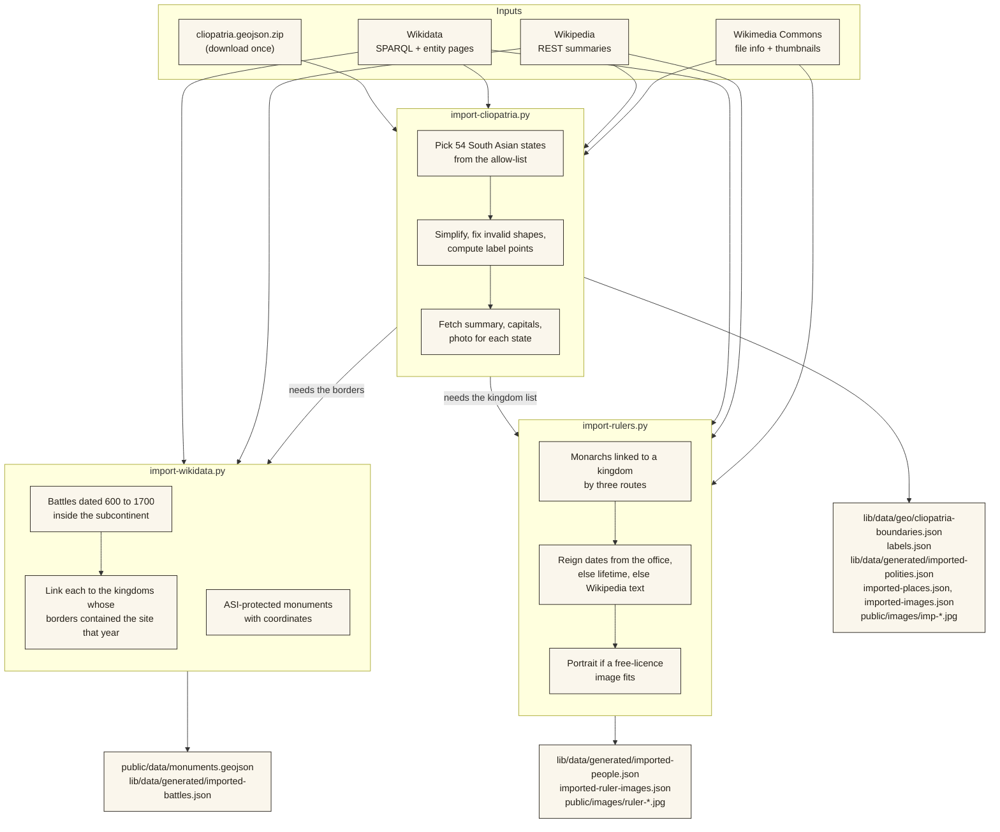

<div align="center">

# Data

Where every record comes from, under what licence, and what is still missing.

[← Back to the README](../README.md)

</div>

---

## Contents

1. [The rule](#1-the-rule)
2. [Sources and licences](#2-sources-and-licences)
3. [The pipeline](#3-the-pipeline)
4. [Running the importers](#4-running-the-importers)
5. [What each file holds](#5-what-each-file-holds)
6. [How honesty is built in](#6-how-honesty-is-built-in)
7. [Known gaps](#7-known-gaps)
8. [Adding a new source](#8-adding-a-new-source)

---

## 1. The rule

> **Never present invented history as real.** No made-up dates, rulers, sources, or borders. A record either names where it came from, or its page says it is a placeholder.

Three related rules follow from it:

- **Unknown is not empty.** A ruler with no known reign dates is shown with their lifetime, labelled "Lived", never with a guessed reign.
- **Uncertain is not false.** Borders are shown with a hatched or dashed edge where the line is not known.
- **Imported is not endorsed.** Open datasets are used because they are cited and checkable, not because they are final. Every page that uses one says which.

---

## 2. Sources and licences

| Data | Source | Licence | Where it is credited |
|---|---|---|---|
| Kingdom borders and dates | [Cliopatria](https://github.com/Seshat-Global-History-Databank/cliopatria), Seshat Global History Databank. Bennett et al., *Scientific Data* 12, 247 (2025). [doi:10.1038/s41597-025-04516-9](https://doi.org/10.1038/s41597-025-04516-9) | CC BY 4.0 | Each kingdom page (Sources), the Method page, the footer, and saved map images |
| Kingdom and ruler summaries, battle descriptions; ruler names and reigns for kingdoms Wikidata has no monarchs for | English Wikipedia: opening paragraphs, lightly trimmed, and the dated tables in its "List of …" articles | CC BY-SA 4.0 | Each page's Sources list names the article or list |
| Capitals and their coordinates; battles; rulers' roles and dates; protected monuments; dated temples, mosques, forts and tombs; native-script and alternative names | [Wikidata](https://www.wikidata.org) | CC0 | Each page's Sources list; Method page |
| Photographs of kingdoms and places, ruler portraits, and the thumbnails shown for dated sites (linked from Commons, not copied) | [Wikimedia Commons](https://commons.wikimedia.org) | Per file: only CC BY, CC BY-SA, CC0 and public domain are accepted | Photographer, licence and link under every image; full list on the Method page |
| Inscription translation | *South Indian Inscriptions*, Vol. II (Archaeological Survey of India, 1913), scan from the Digital Library of India | Public domain | The evidence page's source chain, with a link to the scan |
| Chera outline (placeholder) | [indian-district-boundaries](https://github.com/guneetnarula/indian-district-boundaries) | MIT | Method page |
| Base map | © CARTO, © OpenStreetMap contributors | ODbL (data); CARTO terms (tiles) | Map attribution control, Method page |
| Terrain | Terrain Tiles (Mapzen), AWS Open Data | Open; attribution required | Map attribution control, Method page |

Wikipedia's licence (CC BY-SA 4.0) requires attribution and share-alike. Each summary is shown with its article named in the page's Sources list, and the importer keeps only the opening sentences.

---

## 3. The pipeline

Data is imported by Python scripts that you run by hand. Their output is committed to the repository, so the site builds offline and every data change is a reviewable diff. The diagram shows the three main importers; the table under it lists the rest.



Order matters: run `import-cliopatria.py` first, then the others, which read its output.

| Script | Reads | Writes |
|---|---|---|
| `import-names.py` | The caches the three importers above wrote | Native-script and alternative names |
| `import-sites.py` | Wikidata | `public/data/sites.geojson` |
| `import-ruler-lists.py` | Wikipedia's lists of rulers, and the kingdom list | Rulers for kingdoms Wikidata lacks, and which Wikidata records they replace |
| `check-places.py` | Wikidata | Item and coordinates for each hand-written place |
| `import-place-photos.py` | `check-places.py` output, Commons | Photographs and credits for places |
| `import-photos.py` | Commons (a human picks) | Photographs and credits for kingdoms |
| `apply-corrections.py` | The generated files | The documented fixes, re-applied after any import |
| `validate-data.py` | Everything, and the web | A list of problems; changes nothing |

All network responses are cached in a `cache/` folder inside the directory you run from, so reruns are fast, offline, and give identical results.

---

## 4. Running the importers

You only need this to refresh or extend the data. Normal development does not need Python.

```bash
# 1. A scratch directory OUTSIDE the repository, so the cache is not committed
mkdir -p ~/bharata-import && cd ~/bharata-import

# 2. Python with shapely
python3 -m venv venv
venv/bin/pip install shapely pillow     # Pillow is only for import-photos.py candidates

# 3. The Cliopatria dataset (about 44 MB zipped)
curl -L -o clio.zip \
  https://raw.githubusercontent.com/Seshat-Global-History-Databank/cliopatria/main/cliopatria.geojson.zip
unzip -o clio.zip          # gives cliopatria_polities_only.geojson (use the file with that name)

# 4. Run the importers, in this order, from this directory
REPO=/path/to/BHAARATA
venv/bin/python $REPO/scripts/import-cliopatria.py
venv/bin/python $REPO/scripts/import-wikidata.py
venv/bin/python $REPO/scripts/import-rulers.py
venv/bin/python $REPO/scripts/import-names.py      # reads the caches written above
venv/bin/python $REPO/scripts/import-sites.py
venv/bin/python $REPO/scripts/import-ruler-lists.py   # one request per 2.5 s: Wikipedia rate-limits faster
venv/bin/python $REPO/scripts/check-places.py        # one request every 2 s
venv/bin/python $REPO/scripts/import-place-photos.py # needs check-places first
venv/bin/python $REPO/scripts/apply-corrections.py   # after the importers: re-applies the documented fixes
venv/bin/python $REPO/scripts/validate-data.py       # audits every record and link; read what it prints

# Photographs are chosen by eye, in two steps (see the docstring in the script):
venv/bin/python $REPO/scripts/import-photos.py candidates   # writes contact sheets to cache/
# ...edit PICKS in the script, then:
venv/bin/python $REPO/scripts/import-photos.py download
```

Each script prints a summary when it finishes, for example `Imported 185 rulers; …`. Check it, then review the diff before committing.

If Wikidata times out (it sometimes does), just run the script again: finished requests are cached and it resumes where it stopped.

### Corrections, and the audit

`scripts/validate-data.py` checks every record against itself (duplicate ids, impossible dates, coordinates outside the map, rulers outside their kingdom's years, missing credits, files on disk) and against the web (every Wikipedia article exists and is the right subject, every Wikidata id keeps its label, every Commons photo is still there and still free-licensed). Its first run found, among other things: a consort and a Marwar ruler listed as Mughal emperors, two Mysore kings with the same reign, battle summaries that described Shivaji's whole biography or a whole war, and a kingdom whose summary came from a disambiguation page.

Each fix is recorded with its reason in `scripts/apply-corrections.py`, not edited by hand into the generated files, so a re-import does not bring the error back. What the validator still reports (11 items) is real and open: six battles known only from Wikidata, the Chera with no border shapes, two rulers without a summary, and two Wikipedia titles that redirect to a differently named article (to be checked as the same subject).

### What the scripts decide by hand

Automatic imports need a few human judgements. They are written down in the scripts, in plain lists you can edit:

| List | Script | Purpose |
|---|---|---|
| `INCLUDE` | `import-cliopatria.py` | Which Cliopatria states count as "South Asian kingdoms", and the id and display name each gets |
| `CURATED` | `import-cliopatria.py` | Kingdoms whose text is hand-written in `prototype.ts`; the importer only supplies their borders and dates |
| `IMAGE_OK` | `import-cliopatria.py` | The few photographs checked by eye and kept. Automatically chosen images are often wrong (a map, a railway station), so none is used unless listed |
| `REGION_OVERRIDE`, `SKIP_PLACES`, `WIKI_TITLE` | `import-cliopatria.py` | Corrections where an automatic guess is wrong |
| `POSITION_TO_POLITY` | `import-rulers.py` | Which Wikidata position ("Chola king", "Sultan of Delhi") means which kingdom |
| image title filter | `import-rulers.py` | Rejects "portraits" that are really maps, tombs or gardens |

---

## 5. What each file holds

| File | Made by | Contents |
|---|---|---|
| `lib/data/geo/cliopatria-boundaries.json` | `import-cliopatria` | 465 dated border shapes: `polityId`, `validFrom`, `validTo`, source name, GeoJSON geometry |
| `lib/data/geo/labels.json` | `import-cliopatria` | The point where each shape's name is printed (its pole of inaccessibility) |
| `lib/data/geo/boundaries.json`, `frontiers.json` | by hand | Chera's placeholder outline and its hatched edge |
| `lib/data/generated/imported-polities.json` | `import-cliopatria` | 54 kingdoms: name, dates, summary, capitals, region, colour, image key |
| `lib/data/generated/imported-places.json` | `import-cliopatria` | Capital cities with coordinates and Wikidata ids |
| `lib/data/generated/imported-images.json` | `import-cliopatria` | Credit (artist, licence, link) for each kingdom photo |
| `lib/data/generated/imported-battles.json` | `import-wikidata` | 127 battles: year, location, summary, kingdoms whose borders contained the site |
| `public/data/monuments.geojson` | `import-wikidata` | 4,313 protected monuments (name, id, Wikipedia title) |
| `public/data/sites.geojson` | `import-sites` | 344 temples, mosques, churches, forts, tombs and palaces in the subcontinent and Afghanistan with a known date of construction (600–1700; Tibet, Iran and Central Asia are filtered out by Wikidata's country). 252 carry a linked Commons thumbnail with its credit; the images are not copied into the repository |
| `lib/data/generated/imported-names.json` | `import-names` | Native-script names (Tamil, Kannada, Persian, Gujarati…) and alternative English names, taken from Wikidata labels and never transliterated by us |
| `lib/data/generated/imported-ruler-lists.json` | `import-ruler-lists` | About 560 rulers of 44 kingdoms, read from Wikipedia's dated lists (tables, bullet lists, or rows entered by hand from the article, all in the script); each names its list page. A reign given only as a start year ends where the next begins, and says so. Where a list gives a reign and Wikidata only a lifetime, the list replaces it |
| `lib/data/generated/place-photos.json` | `import-place-photos` | Credit for the Wikidata image of 11 places, each checked for a free licence. Two places (Manyakheta, Kannauj) were left without a picture because Wikidata's image was a railway station and a different town's temple |
| `lib/data/generated/place-wikidata.json` | `check-places` | Wikidata item and coordinates for each of the 24 hand-written places (it found Halebidu typed 25 km off) |
| `lib/data/generated/photos.json` | `import-photos` | Credit for 35 hand-picked kingdom photographs (`public/images/kp-*.jpg`) |
| `lib/data/generated/imported-people.json` | `import-rulers` | Rulers: dates, whether they are a reign or a lifetime, role, summary |
| `lib/data/generated/imported-ruler-images.json` | `import-rulers` | Credit for each ruler image (32; 3 are not shown, see section 7) |
| `lib/data/prototype.ts` | by hand, plus the merge | Hand-written records, and the code that merges everything above into typed arrays |
| `lib/data/images.ts` | by hand, plus the merge | Credits for hand-picked photographs |
| `lib/data/story.ts` | by hand | The four homepage chapters |

`lib/data/prototype.ts` is where imported and hand-written records meet. Imported records are mapped into the same `Polity`, `Person`, `Place` and `HistoricalEvent` types, with provenance pointing at the right source.

---

## 6. How honesty is built in

| Mechanism | What it does |
|---|---|
| **Provenance on every record** | A `provenance` list names the source and what it supports ("Borders and dates", "Summary", "Role and reign dates") |
| **A status badge computed from provenance** | `lib/data/status.ts` turns the list into the badge text, so a label cannot disagree with the data |
| **`datesAre: "reign" \| "lifetime"`** | Wikidata often has only life dates. These are shown as "Lived …", with a paler bar, never as a reign |
| **Dates read from text are marked** | Six reigns were read from Wikipedia sentences (`r. 1296–1316`) because Wikidata lacked them. Their provenance says so |
| **Date qualifiers** | `formatDateRange()` prints `c.`, `before`, `after` or `unknown`; it never invents precision |
| **Battles linked by place, not by combatants** | Wikidata rarely records who fought, so each battle lists the kingdoms whose borders contained the site that year, and says exactly that |
| **Monuments are "protected today"** | Wikidata has no construction date in 600–1700 for any of them; inventing one would break the rule, so the layer is not tied to a year |
| **The provenance chain on evidence pages** | Each step from object to claim is marked real, partly real, or placeholder; a missing step (the Tamil text) is shown as missing |
| **No guessing at machine-read text** | The scan of *South Indian Inscriptions* has garbled Tamil. Only the clean English translation is used |
| **Free licences only for images** | Anything with a non-commercial or no-derivatives term is rejected by the importer |

---

## 7. Known gaps

These are known limits of the current data, not bugs. They are tracked in [`BACKLOG.md`](BACKLOG.md).

### Rulers

Every kingdom now has at least one ruler, about 670 in all, with reign dates. They come from three routes: Wikidata (office and dates), Wikipedia's dated lists of rulers (`import-ruler-lists.py`), and a few hand-written records checked against their Wikipedia article. Where a list gives a reign and Wikidata only a lifetime, the reign replaces it. The biggest lists: Anuradhapura (52), Bengal Sultanate (36), Delhi Sultanate (32), Kashmir Sultanate (32), Vijayanagara (28), Chola (20).

What is still thin, and why:

- **Harsha's Empire (1), Kampili (2), the Maratha kingdom (3), the Thanjavur Nayaks (4):** the sources name no more rulers in the years the atlas covers.
- **Pala, Gurjara-Pratihara and the Kalyani Chalukya (1 each):** only the hand-written ruler; no list has been imported for them yet.
- **Reign dates are approximate** wherever a source gives "c." years (Maitraka, Chera, Habbarid), and some sources disagree by a few years (the page gives the table's figure).
- **Few have a summary.** Rulers from lists have a name, role and dates only; the page says so instead of leaving a blank.
- 211 Wikidata candidates were skipped because Wikidata gave no usable dates for them.

### Borders

- Cliopatria's borders are **one researched version** of each territory. Historians disagree about many of them, and shapes of neighbouring kingdoms sometimes overlap.
- Only the **Chera** have no Cliopatria entry; their outline is a placeholder built from modern Kerala districts.
- Borders change at the dataset's own time steps (from a few years to a few decades), not at the exact year a frontier moved.

### Content

- **Evidence:** two real inscription translations (SII Vol. II, nos. 85 and 88), each read from the printed page. The photograph beside each is of a *different* inscription and is labelled so. There is no transcription of the Tamil text.
- **Hand-written text** for the eleven curated kingdoms, their eleven rulers and the nine turning points was checked, statement by statement, against the Wikipedia article named in each record (the audit corrected about 25 statements). It is still our paraphrase, not a scholarly text.
- **Not researched:** the **routes** (two example lines, drawn by hand and labelled so on the map) and the **Chera outline**.
- **Portraits:** 31 of 668 rulers show a free-licence portrait; the rest show an initial. A list record is dropped where a hand-written record covers the same ruler (same kingdom, overlapping years, similar name). A ruler read from a Wikipedia list keeps the portrait of the Wikidata record it replaces, but only when the names match. Three of the 32 downloaded portraits are not shown: Vishnuvardhana (a temple sculpture; nothing confirms it depicts him), Bukka (his record no longer exists) and Krishnadevaraya's second file (the hand-written record has its own).
- **Photographs:** every kingdom has one. Three (Maitraka, Lohara, Dambadeniya) show a coin or temples of the period rather than the capital's best-known building; Gahadavala and Sena show an inscription and pottery.
- **Battles:** 6 of 127 have only a date and place from Wikidata; no source describing them was found.
- **Native-script names** were checked against the same-language Wikipedia titles; one (Kalyani Chalukya) has none because no article title could be confirmed.

---

## 8. Adding a new source

Use this checklist so a new dataset arrives with the same guarantees as the others.

1. **Check the licence first.** It must allow reuse with attribution. Record it in the table in section 2.
2. **Write or extend an importer** in `scripts/`, with a docstring that says what it reads, writes, and how to run it. Cache every network response.
3. **Keep the raw facts apart from your judgement.** Anything you decided by hand (an allow-list, a correction) goes in a named list at the top of the script.
4. **Add a `Source`** (`title`, `citation`, `url`) in `lib/data/prototype.ts`, and give each imported record a `provenance` entry pointing at it.
5. **Teach `lib/data/status.ts` about it** if records from the source should earn a different badge.
6. **Credit it** on the Method page, and under any image or quote that needs attribution.
7. **Check the output by eye**, not just the summary line: look at a sample, at the extremes, and at anything the script skipped.
8. **Update this file**, including any new gap it opens.
