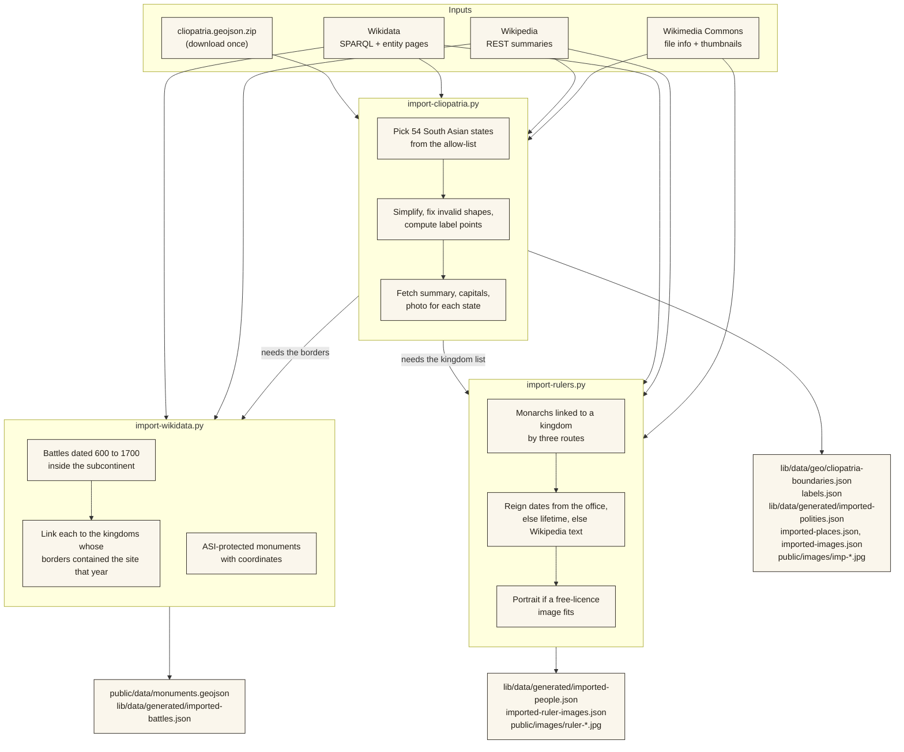

<div align="center">

# Data

Where every record comes from, under what licence, and what is still missing.

[← Back to the README](../README.md)

</div>

---

## Contents

1. [The rule](#1-the-rule)
2. [Sources and licences](#2-sources-and-licences)
3. [The pipeline](#3-the-pipeline)
4. [Running the importers](#4-running-the-importers)
5. [What each file holds](#5-what-each-file-holds)
6. [How honesty is built in](#6-how-honesty-is-built-in)
7. [Known gaps](#7-known-gaps)
8. [Adding a new source](#8-adding-a-new-source)

---

## 1. The rule

> **Never present invented history as real.** No made-up dates, rulers, sources, or borders. A record either names where it came from, or its page says it is a placeholder.

Three related rules follow from it:

- **Unknown is not empty.** A ruler with no known reign dates is shown with their lifetime, labelled "Lived", never with a guessed reign.
- **Uncertain is not false.** Borders are shown with a hatched or dashed edge where the line is not known.
- **Imported is not endorsed.** Open datasets are used because they are cited and checkable, not because they are final. Every page that uses one says which.

---

## 2. Sources and licences

| Data | Source | Licence | Where it is credited |
|---|---|---|---|
| Kingdom borders and dates | [Cliopatria](https://github.com/Seshat-Global-History-Databank/cliopatria), Seshat Global History Databank. Bennett et al., *Scientific Data* 12, 247 (2025). [doi:10.1038/s41597-025-04516-9](https://doi.org/10.1038/s41597-025-04516-9) | CC BY 4.0 | Each kingdom page (Sources), the Method page, the footer, and saved map images |
| Kingdom and ruler summaries, battle descriptions | English Wikipedia, opening paragraph, lightly trimmed | CC BY-SA 4.0 | Each page's Sources list names the article |
| Capitals and their coordinates; battles; rulers' roles and dates; protected monuments | [Wikidata](https://www.wikidata.org) | CC0 | Each page's Sources list; Method page |
| Photographs and portraits | [Wikimedia Commons](https://commons.wikimedia.org) | Per file: only CC BY, CC BY-SA, CC0 and public domain are accepted | Photographer, licence and link under every image; full list on the Method page |
| Inscription translation | *South Indian Inscriptions*, Vol. II (Archaeological Survey of India, 1913), scan from the Digital Library of India | Public domain | The evidence page's source chain, with a link to the scan |
| Chera outline (placeholder) | [indian-district-boundaries](https://github.com/guneetnarula/indian-district-boundaries) | MIT | Method page |
| Base map | © CARTO, © OpenStreetMap contributors | ODbL (data); CARTO terms (tiles) | Map attribution control, Method page |
| Terrain | Terrain Tiles (Mapzen), AWS Open Data | Open; attribution required | Map attribution control, Method page |

Wikipedia's licence (CC BY-SA 4.0) requires attribution and share-alike. Each summary is shown with its article named in the page's Sources list, and the importer keeps only the opening sentences.

---

## 3. The pipeline

Data is imported by three Python scripts that you run by hand. Their output is committed to the repository, so the site builds offline and every data change is a reviewable diff.



Order matters: run `import-cliopatria.py` first, then the other two, which read its output.

All network responses are cached in a `cache/` folder inside the directory you run from, so reruns are fast, offline, and give identical results.

---

## 4. Running the importers

You only need this to refresh or extend the data. Normal development does not need Python.

```bash
# 1. A scratch directory OUTSIDE the repository, so the cache is not committed
mkdir -p ~/bharata-import && cd ~/bharata-import

# 2. Python with shapely
python3 -m venv venv
venv/bin/pip install shapely

# 3. The Cliopatria dataset (about 44 MB zipped)
curl -L -o clio.zip \
  https://raw.githubusercontent.com/Seshat-Global-History-Databank/cliopatria/main/cliopatria.geojson.zip
unzip -o clio.zip          # gives cliopatria_polities_only.geojson (use the file with that name)

# 4. Run the importers, in this order, from this directory
REPO=/path/to/BHAARATA
venv/bin/python $REPO/scripts/import-cliopatria.py
venv/bin/python $REPO/scripts/import-wikidata.py
venv/bin/python $REPO/scripts/import-rulers.py
venv/bin/python $REPO/scripts/import-names.py      # reads the caches written above
venv/bin/python $REPO/scripts/import-sites.py

# Photographs are chosen by eye, in two steps (see the docstring in the script):
venv/bin/python $REPO/scripts/import-photos.py candidates   # writes contact sheets to cache/
# ...edit PICKS in the script, then:
venv/bin/python $REPO/scripts/import-photos.py download
```

Each script prints a summary when it finishes, for example `185 rulers; 113 with reign dates, 72 lifetime only; …`. Check it, then review the diff before committing.

If Wikidata times out (it sometimes does), just run the script again: finished requests are cached and it resumes where it stopped.

### What the scripts decide by hand

Automatic imports need a few human judgements. They are written down in the scripts, in plain lists you can edit:

| List | Script | Purpose |
|---|---|---|
| `INCLUDE` | `import-cliopatria.py` | Which Cliopatria states count as "South Asian kingdoms", and the id and display name each gets |
| `CURATED` | `import-cliopatria.py` | Kingdoms whose text is hand-written in `prototype.ts`; the importer only supplies their borders and dates |
| `IMAGE_OK` | `import-cliopatria.py` | The few photographs checked by eye and kept. Automatically chosen images are often wrong (a map, a railway station), so none is used unless listed |
| `REGION_OVERRIDE`, `SKIP_PLACES`, `WIKI_TITLE` | `import-cliopatria.py` | Corrections where an automatic guess is wrong |
| `POSITION_TO_POLITY` | `import-rulers.py` | Which Wikidata position ("Chola king", "Sultan of Delhi") means which kingdom |
| image title filter | `import-rulers.py` | Rejects "portraits" that are really maps, tombs or gardens |

---

## 5. What each file holds

| File | Made by | Contents |
|---|---|---|
| `lib/data/geo/cliopatria-boundaries.json` | `import-cliopatria` | 465 dated border shapes: `polityId`, `validFrom`, `validTo`, source name, GeoJSON geometry |
| `lib/data/geo/labels.json` | `import-cliopatria` | The point where each shape's name is printed (its pole of inaccessibility) |
| `lib/data/geo/boundaries.json`, `frontiers.json` | by hand | Chera's placeholder outline and its hatched edge |
| `lib/data/generated/imported-polities.json` | `import-cliopatria` | 54 kingdoms: name, dates, summary, capitals, region, colour, image key |
| `lib/data/generated/imported-places.json` | `import-cliopatria` | Capital cities with coordinates and Wikidata ids |
| `lib/data/generated/imported-images.json` | `import-cliopatria` | Credit (artist, licence, link) for each kingdom photo |
| `lib/data/generated/imported-battles.json` | `import-wikidata` | 127 battles: year, location, summary, kingdoms whose borders contained the site |
| `public/data/monuments.geojson` | `import-wikidata` | 4,313 protected monuments (name, id, Wikipedia title) |
| `public/data/sites.geojson` | `import-sites` | 439 temples, mosques, forts, tombs, palaces and monasteries with a known date of construction (600–1700). 271 carry a linked Commons thumbnail with its credit; the images are not copied into the repository |
| `lib/data/generated/imported-names.json` | `import-names` | Native-script names (Tamil, Kannada, Persian, Gujarati…) and alternative English names, taken from Wikidata labels and never transliterated by us |
| `lib/data/generated/photos.json` | `import-photos` | Credit for 30 hand-picked kingdom photographs (`public/images/kp-*.jpg`) |
| `lib/data/generated/imported-people.json` | `import-rulers` | Rulers: dates, whether they are a reign or a lifetime, role, summary |
| `lib/data/generated/imported-ruler-images.json` | `import-rulers` | Credit for each ruler image |
| `lib/data/prototype.ts` | by hand, plus the merge | Hand-written records, and the code that merges everything above into typed arrays |
| `lib/data/images.ts` | by hand, plus the merge | Credits for hand-picked photographs |
| `lib/data/story.ts` | by hand | The four homepage chapters |

`lib/data/prototype.ts` is where imported and hand-written records meet. Imported records are mapped into the same `Polity`, `Person`, `Place` and `HistoricalEvent` types, with provenance pointing at the right source.

---

## 6. How honesty is built in

| Mechanism | What it does |
|---|---|
| **Provenance on every record** | A `provenance` list names the source and what it supports ("Borders and dates", "Summary", "Role and reign dates") |
| **A status badge computed from provenance** | `lib/data/status.ts` turns the list into the badge text, so a label cannot disagree with the data |
| **`datesAre: "reign" \| "lifetime"`** | Wikidata often has only life dates. These are shown as "Lived …", with a paler bar, never as a reign |
| **Dates read from text are marked** | Six reigns were read from Wikipedia sentences (`r. 1296–1316`) because Wikidata lacked them. Their provenance says so |
| **Date qualifiers** | `formatDateRange()` prints `c.`, `before`, `after` or `unknown`; it never invents precision |
| **Battles linked by place, not by combatants** | Wikidata rarely records who fought, so each battle lists the kingdoms whose borders contained the site that year, and says exactly that |
| **Monuments are "protected today"** | Wikidata has no construction date in 600–1700 for any of them; inventing one would break the rule, so the layer is not tied to a year |
| **The provenance chain on evidence pages** | Each step from object to claim is marked real, partly real, or placeholder; a missing step (the Tamil text) is shown as missing |
| **No guessing at machine-read text** | The scan of *South Indian Inscriptions* has garbled Tamil. Only the clean English translation is used |
| **Free licences only for images** | Anything with a non-commercial or no-derivatives term is rejected by the importer |

---

## 7. Known gaps

These are known limits of the current data, not bugs. They are tracked in [`BACKLOG.md`](BACKLOG.md).

### Rulers are uneven

Wikidata links rulers to kingdoms inconsistently, so some kingdoms are well covered and others are empty.

| Coverage | Kingdoms |
|---|---|
| **Good** (10 or more) | Chola (23), Vijayanagara (20), Ghaznavid (18), Delhi Sultanate (17), Polonnaruwa (17), Mughal (11) |
| **Some** (3–9) | 13 kingdoms, including Mysore (9), Hoysala (8), Bijapur, Golconda and the Bahmani |
| **Thin** (1–2) | 13 kingdoms, including Kakatiya, Pala, Pratihara, Sena |
| **None** | 23 kingdoms, including Harsha's Empire, the Chandela, Paramara, Chauhan, Yadava, Kampili, the Nayaks and the Marathas |

211 candidates were skipped because Wikidata gave no usable dates for them.

### Borders

- Cliopatria's borders are **one researched version** of each territory. Historians disagree about many of them, and shapes of neighbouring kingdoms sometimes overlap.
- Only the **Chera** have no Cliopatria entry; their outline is a placeholder built from modern Kerala districts.
- Borders change at the dataset's own time steps (from a few years to a few decades), not at the exact year a frontier moved.

### Content

- **Evidence:** one real inscription translation (SII Vol. II, no. 85). The photograph beside it is of a *different* inscription and is labelled so. There is no transcription of the Tamil text.
- **Hand-written text** for the ten curated kingdoms (summaries, taglines, "remembered for") is unchecked.
- **Turning points** (the nine milestones) and **routes** are hand-written placeholders.
- **Portraits:** 35 of about 190 rulers have a free-licence depiction; the rest show an initial.
- **Photographs:** nine of the 44 imported kingdoms have one; the rest show an outline emblem. Automatic picks were too often wrong to use.

---

## 8. Adding a new source

Use this checklist so a new dataset arrives with the same guarantees as the others.

1. **Check the licence first.** It must allow reuse with attribution. Record it in the table in section 2.
2. **Write or extend an importer** in `scripts/`, with a docstring that says what it reads, writes, and how to run it. Cache every network response.
3. **Keep the raw facts apart from your judgement.** Anything you decided by hand (an allow-list, a correction) goes in a named list at the top of the script.
4. **Add a `Source`** (`title`, `citation`, `url`) in `lib/data/prototype.ts`, and give each imported record a `provenance` entry pointing at it.
5. **Teach `lib/data/status.ts` about it** if records from the source should earn a different badge.
6. **Credit it** on the Method page, and under any image or quote that needs attribution.
7. **Check the output by eye**, not just the summary line: look at a sample, at the extremes, and at anything the script skipped.
8. **Update this file**, including any new gap it opens.
