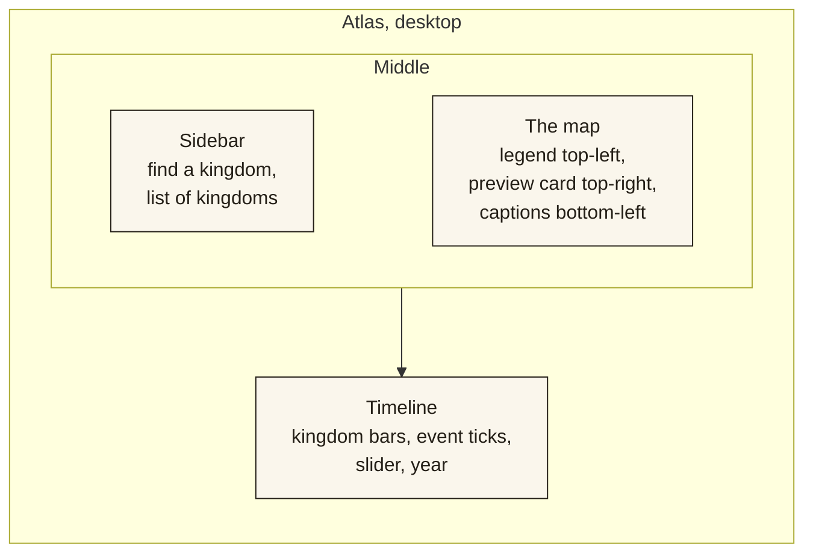

# Design

How BHĀRATA looks, moves and speaks, and the reasons behind each choice.

[← Back to the README](../README.md)

---

## Contents

1. [Identity](#1-identity)
2. [Typography](#2-typography)
3. [Colour](#3-colour)
4. [Layout](#4-layout)
5. [Cartography](#5-cartography)
6. [Motion](#6-motion)
7. [Writing the interface](#7-writing-the-interface)
8. [Accessibility](#8-accessibility)
9. [Checking your work](#9-checking-your-work)

---

## 1. Identity

BHĀRATA should feel like **a printed atlas that came alive**: warm paper, dark ink, a few pigments, fine rules, and type doing the work that boxes and shadows do in most software.

It is not a dashboard, and it is not a museum website. The test for any element is:

> If it does not help the reader understand a **place, a time, a person, a piece of evidence, or the link between them**, it must justify why it is there.

| We use | We avoid |
|---|---|
| Typography, whitespace and thin rules for hierarchy | Cards around everything |
| One dominant object per screen (the map, the kingdom, the object) | Several things competing for attention |
| Asymmetric, editorial layouts | Everything centred and symmetrical |
| Colour for meaning (a kingdom, an uncertainty) | Decorative gradients, glass effects, glows |
| Real photographs, always credited | Stock imagery, fake statistics, decorative icons |
| Honest labels ("Placeholder data") | "AI-powered" badges and marketing fluff |

---

## 2. Typography

Four families, each with one job. All are wired through `lib/fonts.ts`; no component imports its own.

| Role | Family | Where | Notes |
|---|---|---|---|
| **Display** | Zodiak (400, 700) | Headings, kingdom names, years, the wordmark | Self-hosted from Fontshare |
| **Interface** | Ranade (400, 500, 700) | Body text, labels, navigation, metadata | Self-hosted from Fontshare |
| **Indian-script text** | Anek (Devanagari, Tamil, Kannada, Telugu) | Running text in native script | Google Fonts, loaded on demand |
| **Indian-script display** | Tiro (Devanagari Hindi, Tamil, Kannada, Telugu) | Native-script names under headings | Google Fonts, loaded on demand |

Rules of thumb:

- **Tracking carries hierarchy.** Small caps-style labels ("eyebrows") use wide letter-spacing (`0.14em` to `0.25em`); large headings use none.
- **Numbers are tabular** wherever they align in a column (dates, years).
- **Line length** for reading text is capped around 65 characters (`max-w-prose`).
- **The same fonts draw the map's labels.** Glyphs were generated from Zodiak and Ranade (`public/map-glyphs/`), so a name on the map matches a name on the page.
- **Native names are set as writing, not decoration.** `InkName` lets a native-script name appear with a left-to-right ink sweep, the direction all four scripts are read.

---

## 3. Colour

A narrow palette of paper, ink and a few meaningful pigments. Tokens are CSS variables in `app/globals.css` and mirrored as Tailwind colours.

| Token | Value | Used for |
|---|---|---|
| `--bh-paper` |  `#f3ede0` | Page background |
| `--bh-paper-raised` |  `#faf6ec` | Cards, popups, the palette |
| `--bh-ink` |  `#241f17` | Text, the dark atlas, rules |
| `--bh-ink-muted` |  `#5c5447` | Secondary text |
| `--bh-ash` |  `#8a8273` | Quiet metadata |
| `--bh-stone` |  `#d8cfba` | Fills, empty states |
| `--bh-border` |  `#c9bda1` | Rules and dividers |
| `--bh-water` |  `#9cb8ae` | Sea on the light map |
| `--bh-territory` |  `#b85c38` | Default territory pigment, active controls |
| `--bh-territory-selected` |  `#96341a` | Selection, links on hover |
| `--bh-evidence` |  `#3a5a78` | Evidence accents |
| `--bh-uncertainty` |  `#a68a52` | "Placeholder" badges, uncertainty dots |

**Each kingdom has one pigment.** The eleven hand-written kingdoms have chosen colours; the rest get a colour derived from their id (`accent()` in `import-cliopatria.py`) at fixed lightness and saturation, so they sit comfortably together. On a kingdom's page the pigment becomes `--bh-accent`, which tints text selection, rules, the drop cap and the reading-progress line.

**Colour never carries meaning alone.** Selection is also shown by a thicker outline and a card; uncertainty is also shown by a hatched or dashed edge and words.

**Dark and light.** The atlas is deliberately dark (a lit map table); text pages are light (paper). They are two moods of one palette, not a theme switch.

---

## 4. Layout

### Composition

- **One dominant object per screen.** The atlas is the map. A kingdom page is the kingdom. An evidence page is the object. Everything else supports it.
- **Three depths.** Level 1 is what you see at once (a name and dates). Level 2 appears on click or hover (rulers, places, events). Level 3 is the investigation (an inscription, its translation, its source).
- **Cards are for grouped information only.** Separation comes from `<Rule />`, whitespace and type.
- **Temporary context goes in panels and sheets; lasting context gets a page.** A kingdom's preview card is a panel on the map; "Open the Chola page" leads to a page that can be linked and revisited.

### The atlas screen

On a phone the sidebar becomes a row of kingdom chips, the legend collapses to a "Layers" button, and the preview card becomes a draggable bottom sheet. The map always stays on screen.

### Components

`components/primitives/` holds the small, logic-free pieces (`Eyebrow`, `Rule`, `Badge`, `Button`, `Plate`, `HeroPhoto`, `Odometer`, …). Bigger components compose them; primitives never import application code.

Notable patterns:

| Component | Purpose |
|---|---|
| `Plate` | A photograph framed like a numbered plate in an atlas: keyline, "Plate IV", credit under it |
| `HeroPhoto` | Full-width darkened photo with a slow settle and a parallax sink on scroll; credit in the corner |
| `KingdomEmblem` | A kingdom's outline, filled with its pigment, used as its logo throughout |
| `Odometer` | A year as rolling digits, so a change reads as a counter turning |
| `ProvenanceChain` | The vertical "How we know" thread with real / partly real / placeholder marks |
| `PageTransition`, `Shared` | Wrap a page and a shared element so it morphs between a list and its page |

---

## 5. Cartography

The map should look **printed**, not like a web map with the colours changed.

| Element | Treatment |
|---|---|
| Land | Warm parchment (light atlas) or deeper sand (the homepage globe) |
| Sea | Muted blue-green on the atlas; deep teal on the globe |
| Relief | Hillshade with a warm brown shadow and a paper highlight, so mountains read as engraving |
| Modern borders and country names | **Removed on purpose**, so today's lines do not look like they existed then |
| Kingdoms | Low-opacity pigment fill, a darker outline of the same hue, a spaced-capital name |
| Selected kingdom | Stronger fill and a thicker outline |
| Hover | Slight lift in fill, a soft glow, a small label with name and dates |
| Uncertain frontier | A hatched band (diagonal ink lines) |
| Land recently lost | A dashed outline that fades over 60 years |
| Routes | Fine dashed lines moving in their direction of travel, with arrows; a ship or traveller moves along each |
| Battles | A red ring and a name, shown from the battle's year for ten years |
| Capitals | A small pulse, and a seal (the kingdom's outline in a disc) when zoomed in |

Information should **arrive as you approach**: kingdom names first, then cities, then seals, then smaller places. Labels should never collide; the kingdom-name layer is placed first so it claims its space.

---

## 6. Motion

Motion explains something or it is removed. It should show continuity, hierarchy, cause or a change of state. It should never be there because a page "feels empty".

### The rules

- Animate **`opacity` and `transform`** (and, for the map, `feature-state` paint transitions). Avoid animating width, height, margin or box-shadow.
- **Do not block the reader.** No transition delays the next click.
- **Respect `prefers-reduced-motion`** everywhere. The map's ambient motion does not start, the starfield stands still, the globe jumps to its final view, and playback still works by stepping the year.
- **Do not animate everything at once.** At most a few elements per screen, and staggered.

### The vocabulary

| Moment | Motion | Time |
|---|---|---|
| Page change | Shared elements morph (the card photo becomes the hero); the page slides a short way | ~400 ms |
| Territory in and out | Opacity crossfade between border records | 500 ms |
| Selecting a kingdom | Camera flight to its borders, tilting a little | ~1.8 s |
| Preview panel | Fade and a small slide | 180–280 ms |
| Titles | Letters rise out of a clipped line; native names sweep in | 0.9–1.6 s |
| Year counter | Digits roll | 260–700 ms |
| Evidence viewer | Smooth zoom and pan to a chosen line | 700 ms |
| Homepage film | A timed orbit: spin from the Atlantic, hold, dive, tilt, settle | ~10 s |
| Playback | Pauses 2.4 s on each of the hand-picked turning points | n/a |

The homepage film and cinema view are the only places allowed to be long. Ordinary navigation must stay quick.

---

## 7. Writing the interface

Plain language is a design requirement, not a polish step. A first-time visitor should understand every word.

### Principles

1. **Say what it is.** "Kingdoms" not "Polities". "How we know" not "Epistemic exploration". "Placeholder data" not "Illustrative prototype data".
2. **No jargon and no filler.** Cut anything like "immersive", "seamless", "leverage", "powered by".
3. **Short sentences, real nouns.** If a sentence needs rereading, split it.
4. **Say what is uncertain, and why.** "Borders are one researched version, not exact frontiers" is better than a bare "approximate".
5. **Name the source where a claim is made.** And say when there is none.
6. **Do not decorate with quotation marks.** A tagline is a description, not a quotation from someone.

### Examples from this project

| Before | After |
|---|---|
| Semantic exploration | Every kingdom in the atlas |
| Terrain relief | Hills and rivers |
| Illustrative prototype data | Placeholder data, not yet checked |
| Claim · Interpretation · Uncertainty | What it shows · How it's read · How sure we are |
| Cinema view | Full screen |
| Contemporaries | Same period |

### Dates and numbers

- Print dates with `formatDateRange()` or `formatPersonDates()`. They add `c.`, `before`, `after` and "Lived" as needed.
- Use *CE* after years in prose and in the interface; use plain numbers in tight axes.
- Do not round to look neater than the record: if the source says 1192, do not write "around 1200".
- Write counts in full ("3 events", not "3 evt"), and singular or plural correctly.

---

## 8. Accessibility

Designed in, not patched on.

- **Keyboard first.** Every control is reachable and operable by keyboard. The timeline is a native `<input type="range">`, so arrow keys, Home and End work. The atlas has single-key shortcuts that stand down while a dialog is open or a field is focused.
- **Focus is visible** everywhere, and focus order follows reading order.
- **The map has a text alternative:** the kingdom list, the chips and the preview card all expose the same information, and the page says what the map shows.
- **No colour-only signals** (see section 3).
- **Touch targets** are at least about 36 px, larger on the timeline thumb.
- **Images** have alt text describing what they show, and every credit is a real link.
- **Native-script text** is set in its own fonts, and the evidence viewer's label tells screen-reader users which keys zoom and move.
- **Reduced motion** is respected (see section 6).

---

## 9. Checking your work

Before calling a screen done, look at it, not just at the build.

- [ ] Is there one dominant object, and is the hierarchy obvious?
- [ ] Could 10% be removed without loss? Is anything shouting for no reason?
- [ ] Can a stranger understand the page in five seconds, and explore it for thirty minutes?
- [ ] Are labels readable, and is the map calm at this zoom?
- [ ] Is the selected thing obvious without relying on colour?
- [ ] Does the keyboard reach everything? Does Back work? Does the URL reproduce the view?
- [ ] Does it work with reduced motion on?
- [ ] Is it usable at 390 px wide, with one hand?
- [ ] Are loading, empty and error states handled?
- [ ] Is every claim sourced, and every placeholder labelled?
- [ ] Are there console errors or hydration warnings?
