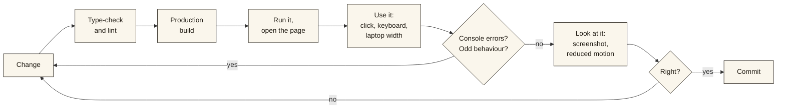

<div align="center">

# Development

Setting up, changing things safely, shipping, and fixing what breaks.

[← Back to the README](../README.md)

</div>

---

## Contents

1. [Setup](#1-setup)
2. [Everyday commands](#2-everyday-commands)
3. [The verification loop](#3-the-verification-loop)
4. [Recipes](#4-recipes)
5. [Deployment](#5-deployment)
6. [Git](#6-git)
7. [Troubleshooting](#7-troubleshooting)
8. [Sound and voice](#8-sound-and-voice)

---

## 1. Setup

**You need:** Node.js 20.19 or newer, npm, Docker Compose, and a browser with WebGL. Python is only needed to refresh data ([`DATA.md`](DATA.md#4-running-the-importers)).

```bash
git clone git@github.com:varunaditya27/BHAARATA.git
cd BHAARATA

npm install
cp .env.example .env.local
docker compose up -d database
npm run db:setup
npm run dev
```

Open <http://localhost:3000>.

`npm install` generates the Prisma client and runs `scripts/copy-maplibre-worker.mjs`, which copies MapLibre's web worker into `public/vendor/`. That folder is git-ignored and recreated on every install. If it is missing, the map shows "Worker failed to load".

### Environment

| Variable | Needed for | Default |
|---|---|---|
| `NEXT_PUBLIC_SITE_URL` | The absolute address used in link-preview images (Open Graph). Set it to the deployed origin, with no trailing slash | `http://localhost:3000` |
| `DATABASE_URL` | PostgreSQL connection with PostGIS enabled | Local Docker database on port 55432 |

There are no API keys: the base map and terrain tiles are public.

### Read the Next.js docs that ship with the package

This project uses a recent Next.js whose APIs differ from older releases. Before changing routing, caching, metadata or rendering, read the matching guide in `node_modules/next/dist/docs/`, not a blog post from last year.

---

## 2. Everyday commands

| Command | What it does |
|---|---|
| `npm run dev` | Development server with hot reload on port 3000 |
| `npm run build` | Production build. It also type-checks; historical pages are rendered on request from the database |
| `npm run start` | Serves the production build (use `-- -p 3100` for another port) |
| `npm run lint` | ESLint, with the React compiler rules |
| `npx tsc --noEmit` | Type-check without building |

Use the production build, not the dev server, to judge anything about speed, share images or page transitions.

---

## 3. The verification loop

A passing build proves the code compiles. It does not prove the page works. For every change, follow the loop and actually use the result.



### Checklist

For any feature:

- [ ] `npm run lint` and `npx tsc --noEmit` pass
- [ ] `npm run build` passes
- [ ] No console errors or hydration warnings in the browser
- [ ] Works with the keyboard alone, and at about 390 px wide
- [ ] Works with reduced motion on
- [ ] Loading, empty and error states look right

For a map feature, also:

- [ ] The right source and layer, and the layer respects the legend toggle
- [ ] Selecting and deselecting both work, and Back restores the view
- [ ] Scrubbing the year stays smooth (the map is not rebuilt per frame)
- [ ] The URL reproduces the view

For data, also:

- [ ] Every new record has `provenance`, and the page's badge is correct
- [ ] Dates use the right qualifiers; a lifetime is never shown as a reign
- [ ] Anything uncertain says so
- [ ] `scripts/validate-data.py` reports nothing new ([`DATA.md`](DATA.md#corrections-and-the-audit))

### Automated tests

There are none yet. This is the biggest gap in the tooling; see the [backlog](BACKLOG.md#tests-and-tooling). Until they exist, the checklist above is the safety net.

---

## 4. Recipes

### Change what a year looks like

Everything that decides "what exists in year Y" goes through `getHistoricalState(year)` in `lib/geo/historical-state.ts`. Change it there. Do not add a second year check in a component.

### Add a map layer

1. Add ids to `SOURCE_IDS` and `LAYER_IDS` in `components/map/mapStyle.ts`.
2. Add the source and layer in `addHistoricalLayers` (`components/map/layers.ts`). If the layer is heavy, add it lazily like `ensureMonuments`.
3. If it depends on the year, set its filter or feature-state in `applyHistoricalState` (`components/map/apply-state.ts`). Only write what changed.
4. If it should be toggleable, add an id to `LayerToggleId` and `LAYER_OPTIONS` in `MapLegend.tsx`, and list its layers in `TOGGLE_LAYER_MAP` in `HistoricalMap.tsx`. **A toggle must control something real.**
5. Explain it on the Method page and, if it uses new data, in [`DATA.md`](DATA.md).

### Add or update historical records

All historical records live in PostgreSQL (`prisma/seed.sql` is the deterministic snapshot):

1. Insert or update the rows in PostgreSQL (`kingdoms`, `kingdom_borders`, `people`, `places`, `events`, `historical_items`, `item_text_lines`, `sources`, `images`, `information_sources`).
2. Run `npm run db:check` to verify all 17 tables, PostGIS geometry validity (`ST_IsValid`), foreign keys, and Zod domain schemas.
3. Export the updated snapshot into `prisma/seed.sql`.

### Add a page

1. Create `app/<route>/page.tsx` as a server component, wrapped in `<PageTransition>`.
2. For dynamic routes, provide `generateMetadata` where a page needs a record-specific title. Records are read on request.
3. Add it to the navigation in `components/layout/GlobalNav.tsx` and the footer in `Colophon.tsx` if it should be linked.
4. Use `<Link transitionTypes={NAV_FORWARD}>` (or `NAV_BACK`) so the page transition has a direction.
5. Add a share image if it is a shareable record (see `app/polities/[slug]/opengraph-image.tsx`).

### Write interface text

Follow [`DESIGN.md`](DESIGN.md#7-writing-the-interface). In short: plain words, no jargon, say what is uncertain, name the source.

---

## 5. Deployment

An earlier version is available at <https://bhaarata.vercel.app>. The database-backed changes in this checkout have not been deployed or verified there.

1. Import the repository in Vercel. The framework is detected as Next.js; no build settings are needed.
2. Provision PostgreSQL with PostGIS, import the reviewed data into a new empty database, and set `DATABASE_URL` in the deployment environment. Do not use the local Docker credentials in production.
3. Set `NEXT_PUBLIC_SITE_URL` to the public origin, with no trailing slash. Without it, link previews point at `localhost`.
4. Deploy the reviewed code. The build generates the Prisma client and copies the map worker.

After a deploy, check:

- `/` shows the opening film and the globe appears within a few seconds
- `/atlas` loads the map and scrubbing works
- A kingdom page's share image loads (`/polities/chola/opengraph-image`)
- `/nowhere` shows the "Uncharted waters" page with a 404 status

---

## 6. Git

- Work on a branch; merge to `main` when it builds and you have used it.
- Keep commit messages **short and plain**: "Add battles layer", not a paragraph.
- **Do not add AI co-author trailers** to commits.
- Commit generated data (`lib/data/generated`, `public/data`, and the photographs the scripts download to `public/images/`) together with the script change that produced it, so the diff explains itself.
- Do not commit `.env.local`. Run the importers from a scratch directory outside the repository, so their `cache/` folder never lands in it.

---

## 7. Troubleshooting

| Symptom | Likely cause | Fix |
|---|---|---|
| Map says **"Worker failed to load"** | `public/vendor/` is missing | Run `npm install`, or `node scripts/copy-maplibre-worker.mjs` |
| Map is blank or black with a compass that never goes away | WebGL unavailable, or the style or tiles failed to load | Check the console and network tab; the loading cover lifts after 4 s at most |
| Labels are boxes or missing | Glyph files missing from `public/map-glyphs/` | Restore them from git; they are committed |
| Terrain looks flat | Terrain tiles still loading, or a slow connection | Terrain fills in after the map appears; the hillshade layer can be toggled |
| Homepage shows only stars and the title | The globe fades in once its first tiles are drawn (up to about two seconds), or WebGL failed | Wait a moment; if it never appears, check the console for WebGL errors |
| Share image is a broken link | `NEXT_PUBLIC_SITE_URL` is wrong or unset | Set it to the real origin and redeploy |
| A new `public/` folder 404s in dev | Next's dev server does not pick up new top-level folders in `public/` | Restart `npm run dev` |
| **React compiler lint error** such as "cannot access refs during render" or "calling setState in an effect" | The code reads a ref, or sets state, in a way the compiler rules forbid | Move ref access into an effect; for "reset state when a prop changes", use the render-phase pattern (compare with a stored previous value) as in `AtlasView` |
| An importer script fails with HTTP 504 | Wikidata's query service timed out | Run it again; finished requests are cached |
| An importer returns "maxlag" errors | Wikidata refuses clients that send a `maxlag` setting while its servers are busy | The importers do not send it; do not add it back |
| `npm install kokoro-js` fails in `onnxruntime-node` | Its install step looks for CUDA 12 and finds a newer one | Use the Python route in section 8 |
| Port 3000 is taken | Another dev server | `npm run dev -- -p 3001` |

---

## 8. Sound and voice

Two things make sound, and both are files in `public/`, so the running site needs no key and no server for audio.

| What | Where | Made by |
|---|---|---|
| A spoken description of every page, about 20 seconds each | `public/narration/<key>.mp3` and `scripts.json` (the text) | Kokoro, a free voice model that runs on this machine |
| Interface sounds: click, hover, slider tick, page whoosh, bell, gong, pluck, chime | `public/sfx/*.mp3` | `scripts/generate-sfx.py`, synthesised with numpy |

The app reads `public/audio-manifest.json`, which lists the clips and sounds that exist, and asks only for those: a page with no recorded clip stays quiet and makes no request, and with no manifest at all the app runs silently. `npm run audio:index` rebuilds the list, and the speech script runs it as clips are added.

A page's clip is named after its address: `/` is `home`, `/people/rajaraja-i` is `people-rajaraja-i`. `components/audio/AudioControls.tsx` plays the clip when the page changes, and listens for clicks, hovers and the timeline slider to play the interface sounds. Browsers allow sound only after a click or key press, so the first visit shows a one-time prompt; the choice is remembered in the browser (`bh-voice`, `bh-effects`).

### Making the audio

Needs Python 3.12, a GPU is optional (about 5 times faster than CPU), `ffmpeg`, and `espeak-ng`.

```bash
uv venv --python 3.12 ~/.venvs/bhaarata-audio-gpu
uv pip install --python ~/.venvs/bhaarata-audio-gpu/bin/python torch --index-url https://download.pytorch.org/whl/cu128 --extra-index-url https://pypi.org/simple
uv pip install --python ~/.venvs/bhaarata-audio-gpu/bin/python kokoro soundfile numpy num2words faster-whisper "av<16" nvidia-cublas-cu12 nvidia-cudnn-cu12 \
  "en_core_web_sm @ https://github.com/explosion/spacy-models/releases/download/en_core_web_sm-3.8.0/en_core_web_sm-3.8.0-py3-none-any.whl"

npm run narration:text        # writes the words for every page from the database
export LD_LIBRARY_PATH=~/.venvs/bhaarata-audio-gpu/lib/python3.12/site-packages/nvidia/cublas/lib:~/.venvs/bhaarata-audio-gpu/lib/python3.12/site-packages/nvidia/cudnn/lib
~/.venvs/bhaarata-audio-gpu/bin/python scripts/synthesize-narration.py     # speaks them; skips clips that exist
```

The voice is `af_heart`, Kokoro's best-rated English voice, at speed 0.95. Years are spoken as people say them ("nine eighty-five"), and "Rajaraja I" as "Rajaraja the First". Names the model reads badly are respelled in `RESPELL` in `scripts/synthesize-narration.py`.

### Listening to the result

`scripts/check-narration.py` is how a developer, or an AI agent, hears the audio without ears. It transcribes a random sample with Whisper and compares the transcript with the script. It also measures length, loudness and long pauses with ffmpeg.

```bash
~/.venvs/bhaarata-audio-gpu/bin/python scripts/check-narration.py --sample 40
```

Read the "heard differently" list at the end. A word the transcriber got wrong is either a mispronunciation (add a respelling and test it) or just an odd spelling (ignore it). Clips should land near 20 seconds at about -19 LUFS. Spectrograms of any clip are one ffmpeg command: `ffmpeg -i clip.mp3 -lavfi showspectrumpic=s=900x300 out.png`.

For the interface sounds, run `python scripts/generate-sfx.py`, then check each file the same way.
