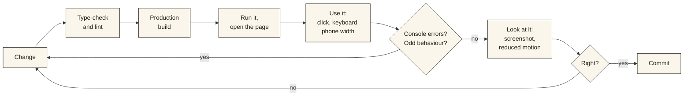

<div align="center">

# Development

Setting up, changing things safely, shipping, and fixing what breaks.

[← Back to the README](../README.md)

</div>

---

## Contents

1. [Setup](#1-setup)
2. [Everyday commands](#2-everyday-commands)
3. [The verification loop](#3-the-verification-loop)
4. [Recipes](#4-recipes)
5. [Deployment](#5-deployment)
6. [Git](#6-git)
7. [Troubleshooting](#7-troubleshooting)

---

## 1. Setup

**You need:** Node.js 20 or newer, npm, and a browser with WebGL. Python is only needed to refresh data ([`DATA.md`](DATA.md#4-running-the-importers)).

```bash
git clone git@github.com:varunaditya27/BHAARATA.git
cd BHAARATA

npm install
cp .env.example .env.local
npm run dev
```

Open <http://localhost:3000>.

`npm install` runs a `postinstall` step (`scripts/copy-maplibre-worker.mjs`) that copies MapLibre's web worker into `public/vendor/`. That folder is git-ignored and recreated on every install. If it is missing, the map shows "Worker failed to load".

### Environment

| Variable | Needed for | Default |
|---|---|---|
| `NEXT_PUBLIC_SITE_URL` | The absolute address used in link-preview images (Open Graph). Set it to the deployed origin, with no trailing slash | `http://localhost:3000` |

Nothing else is configured by environment. There are no API keys: the base map and terrain tiles are public.

### Read the Next.js docs that ship with the package

This project uses a recent Next.js whose APIs differ from older releases. Before changing routing, caching, metadata or rendering, read the matching guide in `node_modules/next/dist/docs/`, not a blog post from last year.

---

## 2. Everyday commands

| Command | What it does |
|---|---|
| `npm run dev` | Development server with hot reload on port 3000 |
| `npm run build` | Production build. It also type-checks, and pre-renders every kingdom, person, place and evidence page |
| `npm run start` | Serves the production build (use `-- -p 3100` for another port) |
| `npm run lint` | ESLint, with the React compiler rules |
| `npx tsc --noEmit` | Type-check without building |

Use the production build, not the dev server, to judge anything about speed, share images or page transitions.

---

## 3. The verification loop

A passing build proves the code compiles. It does not prove the page works. For every change, follow the loop and actually use the result.



### Checklist

For any feature:

- [ ] `npm run lint` and `npx tsc --noEmit` pass
- [ ] `npm run build` passes
- [ ] No console errors or hydration warnings in the browser
- [ ] Works with the keyboard alone, and at about 390 px wide
- [ ] Works with reduced motion on
- [ ] Loading, empty and error states look right

For a map feature, also:

- [ ] The right source and layer, and the layer respects the legend toggle
- [ ] Selecting and deselecting both work, and Back restores the view
- [ ] Scrubbing the year stays smooth (the map is not rebuilt per frame)
- [ ] The URL reproduces the view

For data, also:

- [ ] Every new record has `provenance`, and the page's badge is correct
- [ ] Dates use the right qualifiers; a lifetime is never shown as a reign
- [ ] Anything uncertain says so

### Automated tests

There are none yet. This is the biggest gap in the tooling; see the [backlog](BACKLOG.md#tests-and-tooling). Until they exist, the checklist above is the safety net.

---

## 4. Recipes

### Change what a year looks like

Everything that decides "what exists in year Y" goes through `getHistoricalState(year)` in `lib/geo/historical-state.ts`. Change it there. Do not add a second year check in a component.

### Add a map layer

1. Add ids to `SOURCE_IDS` and `LAYER_IDS` in `components/map/mapStyle.ts`.
2. Add the source and layer in `addHistoricalLayers` (`components/map/layers.ts`). If the layer is heavy, add it lazily like `ensureMonuments`.
3. If it depends on the year, set its filter or feature-state in `applyHistoricalState` (`components/map/apply-state.ts`). Only write what changed.
4. If it should be toggleable, add an id to `LayerToggleId` and `LAYER_OPTIONS` in `MapLegend.tsx`, and list its layers in `TOGGLE_LAYER_MAP` in `HistoricalMap.tsx`. **A toggle must control something real.**
5. Explain it on the Method page and, if it uses new data, in [`DATA.md`](DATA.md).

### Add a kingdom

New kingdoms come from the importer, not from hand-editing:

1. Add the Cliopatria name to `INCLUDE` in `scripts/import-cliopatria.py` with an id and display name.
2. Re-run the importers ([`DATA.md`](DATA.md#4-running-the-importers)) and review the diff.
3. Optionally add a checked photo id to `IMAGE_OK`, or a hand-written record to `lib/data/prototype.ts` (and list its id in `CURATED`).

### Add an evidence record

Add an entry to `evidence` in `lib/data/prototype.ts`, and a `Source` with a link to where it can be checked. Be exact about what is real:

- Set `imageIsIllustrative` if the photograph shows a different object.
- Set `textIsIllustrative` / `claimIsIllustrative` only for placeholders.
- Leave `transcription` empty rather than paste text you cannot trust.
- Put the volume, number and page range in the provenance note.

### Add a page

1. Create `app/<route>/page.tsx` as a server component, wrapped in `<PageTransition>`.
2. For dynamic routes, export `generateStaticParams` and `generateMetadata`.
3. Add it to the navigation in `components/layout/GlobalNav.tsx` and the footer in `Colophon.tsx` if it should be linked.
4. Use `<Link transitionTypes={NAV_FORWARD}>` (or `NAV_BACK`) so the page transition has a direction.
5. Add a share image if it is a shareable record (see `app/polities/[slug]/opengraph-image.tsx`).

### Write interface text

Follow [`DESIGN.md`](DESIGN.md#7-writing-the-interface). In short: plain words, no jargon, say what is uncertain, name the source.

---

## 5. Deployment

The site is deployed on [Vercel](https://vercel.com) at <https://bhaarata.vercel.app>.

1. Import the repository in Vercel. The framework is detected as Next.js; no build settings are needed.
2. Set `NEXT_PUBLIC_SITE_URL` for Production to the public origin (for example `https://bhaarata.vercel.app`), with no trailing slash. Without it, link previews point at `localhost`.
3. Push to the production branch. Vercel runs `npm install` (which runs the worker copy) and `npm run build`.

After a deploy, check:

- `/` shows the opening film and the globe appears within a few seconds
- `/atlas` loads the map and scrubbing works
- A kingdom page's share image loads (`/polities/chola/opengraph-image`)
- `/nowhere` shows the "Uncharted waters" page with a 404 status

---

## 6. Git

- Work on a branch; merge to `main` when it builds and you have used it.
- Keep commit messages **short and plain**: "Add battles layer", not a paragraph.
- **Do not add AI co-author trailers** to commits.
- Commit generated data (`lib/data/generated`, `public/data`, `public/images/imp-*`) together with the script change that produced it, so the diff explains itself.
- Do not commit `.env.local` or the importers' `cache/` folder.

---

## 7. Troubleshooting

| Symptom | Likely cause | Fix |
|---|---|---|
| Map says **"Worker failed to load"** | `public/vendor/` is missing | Run `npm install`, or `node scripts/copy-maplibre-worker.mjs` |
| Map is blank or black with a compass that never goes away | WebGL unavailable, or the style or tiles failed to load | Check the console and network tab; the loading cover lifts after 4 s at most |
| Labels are boxes or missing | Glyph files missing from `public/map-glyphs/` | Restore them from git; they are committed |
| Terrain looks flat | Terrain tiles still loading, or a slow connection | Terrain fills in after the map appears; the hillshade layer can be toggled |
| Homepage shows only stars and the title | The globe fades in once its first tiles are drawn (up to about two seconds), or WebGL failed | Wait a moment; if it never appears, check the console for WebGL errors |
| Share image is a broken link | `NEXT_PUBLIC_SITE_URL` is wrong or unset | Set it to the real origin and redeploy |
| A new `public/` folder 404s in dev | Next's dev server does not pick up new top-level folders in `public/` | Restart `npm run dev` |
| **React compiler lint error** such as "cannot access refs during render" or "calling setState in an effect" | The code reads a ref, or sets state, in a way the compiler rules forbid | Move ref access into an effect; for "reset state when a prop changes", use the render-phase pattern (compare with a stored previous value) as in `AtlasView` |
| An importer script fails with HTTP 504 | Wikidata's query service timed out | Run it again; finished requests are cached |
| Port 3000 is taken | Another dev server | `npm run dev -- -p 3001` |
